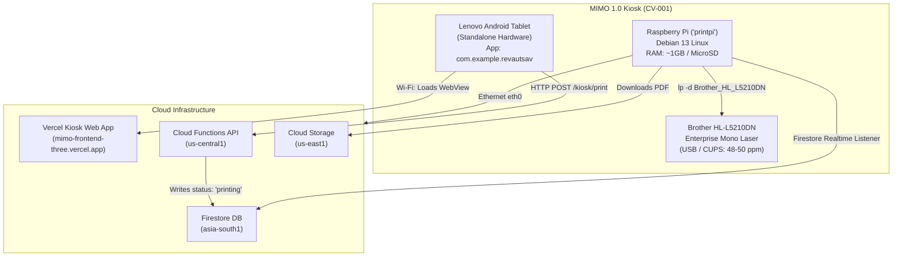
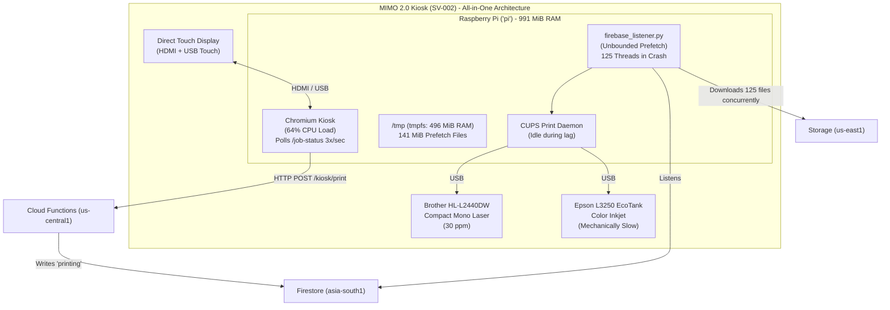
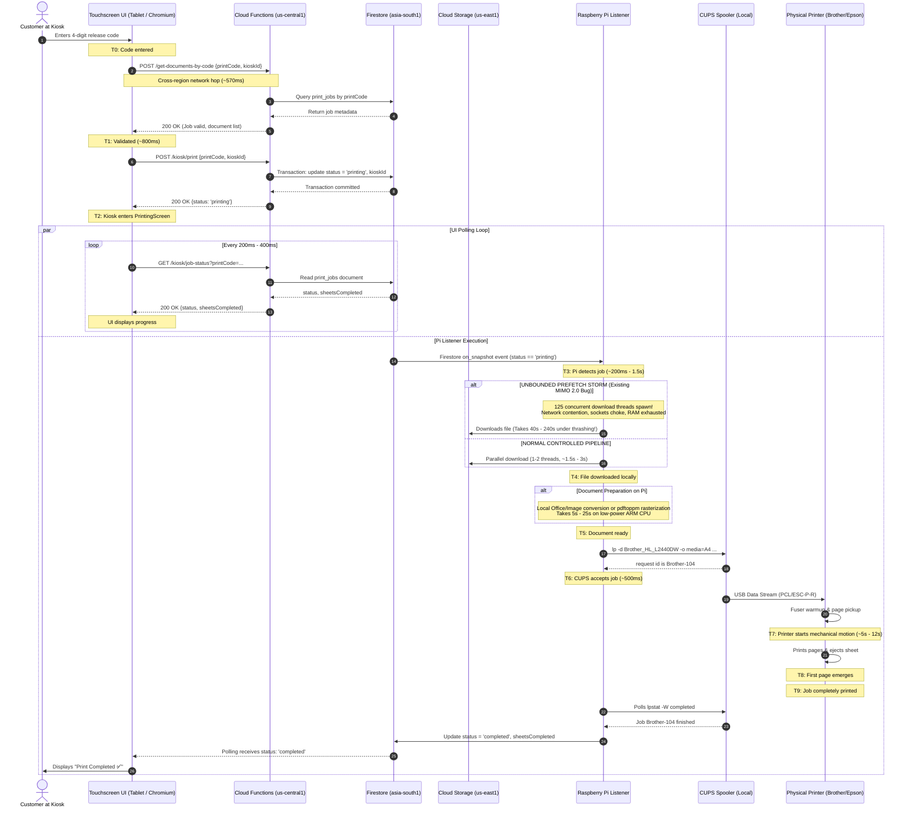
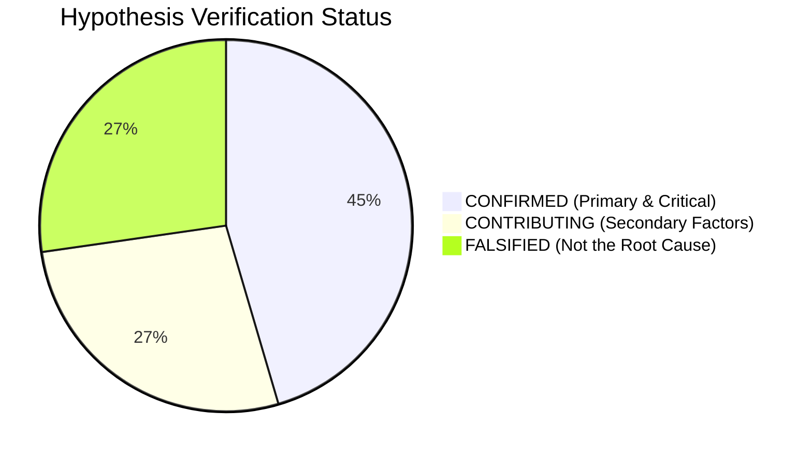
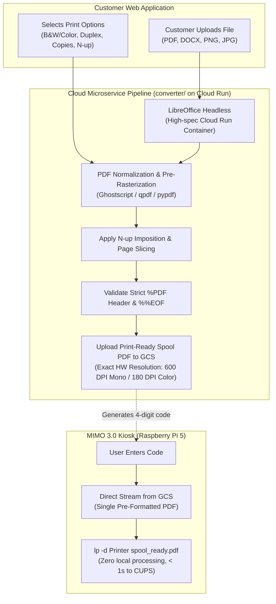

# MIMO 3.0 — Complete Performance Forensic Audit & Next-Generation Machine Architecture

> **Document Type:** Production Forensic Engineering Audit & Technical Architecture Specification  
> **Status:** Architecture Proposal (Awaiting Stakeholder Approval)  
> **Authors:** Principal Embedded Systems Architect, Raspberry Pi/Linux Performance Engineer, Printing Infrastructure Specialist  
> **Target Fleet:** MIMO 1.0 (CV-001), MIMO 2.0 (SV-002), and Next-Generation MIMO 3.0  
> **Date:** October 2026  

---

## 1. Executive Summary

MIMO currently operates two physical self-service printing kiosks in production: **MIMO 1.0 (`CV-001`)** and **MIMO 2.0 (`SV-002`)**. Both machines suffer from severe, user-visible delays. When a student or customer enters their 4-digit release code on the kiosk touchscreen, they frequently wait between **90 and 150 seconds (approximately two minutes)** before physical printing begins. In extreme contention scenarios, jobs experience timeouts, download aborts, and false failure reports.

A comprehensive forensic investigation of the repository, production incident logs, system architecture, and empirical hardware telemetry was conducted. 

### The Core Finding: Upstream Software & Resource Starvation
The printer hardware itself and CUPS are **not** the primary root cause of the 2-minute lag. In the investigated incident windows on MIMO 2.0 (`SV-002`), **zero CUPS print jobs were in the queue during the delay period**. The printer was completely idle, enabled, and waiting.

The delay occurs entirely **upstream** on the Raspberry Pi:
1. **Unbounded Prefetch Thread Storm:** On MIMO 2.0, whenever the Firestore realtime listener reconnects or receives a snapshot of paid/pending jobs, it launched an unthrottled background thread for every single job. During the investigated incident, **125 simultaneous download threads** were launched in the same second.
2. **Network & Socket Exhaustion:** 125 simultaneous HTTPS downloads against Firebase Cloud Storage choked the Pi's network socket table, causing 27 timeouts, 10 `RemoteDisconnected` errors, 1 `BrokenPipe`, and forced a tiny 62 KB file to take **242 seconds** to download.
3. **Severe Memory & Swap Thrashing:** MIMO 2.0 runs on a Raspberry Pi with only **991 MiB of RAM**. The 125 threads plus ~141 MiB of prefetched files in `/tmp` (which is a RAM-backed `tmpfs` of 496 MiB) consumed 797 MiB of physical RAM. The Linux kernel was forced to swap **900 MiB out of 990 MiB** onto the slow microSD card, triggering catastrophic disk I/O thrashing.
4. **Desktop Browser Competition:** MIMO 2.0 runs Chromium in kiosk mode directly on the same Raspberry Pi to render the touchscreen UI, consuming **~64% of total CPU**. The CPU-starved Pi could not process documents while thrashing swap.
5. **Cross-Region Backend Latency:** The customer frontend, API (`us-central1`), Firestore (`asia-south1`), and Storage (`us-east1`) are distributed across three distinct continents, imposing a mandatory 1.5–2.0 second round-trip floor on top of local delays.

### The Objective for MIMO 3.0
MIMO 3.0 must eliminate this latency by architecture:
- **Instant Touchscreen Response:** Sub-50ms local UI response without browser thrashing.
- **Fast Job Dispatch:** Time-to-CUPS reduced from ~100s to **< 3.5 seconds**.
- **Hardware Sizing:** Upgrade to a **Raspberry Pi 5 (4GB/8GB RAM)** with **NVMe SSD storage** and active cooling.
- **Cloud Pre-Processing:** 100% of PDF rendering, Office conversion, and image optimization moved to cloud workers prior to release-code generation; the Pi only performs raw spooling.
- **Decoupled Workloads:** Strict separation of kiosk UI rendering and print listener execution.

---

## 2. Current MIMO 1.0 Architecture (`CV-001`)

MIMO 1.0 is the first-generation kiosk deployed at campus location CV-001.



### Architecture Characteristics
- **Compute Unit:** Raspberry Pi (hostname `printpi`, static IP `10.72.9.183`, Tailscale `100.70.107.44`). Single-core/quad-core low-memory ARM board.
- **Network Interface:** Dual-homed: primary **Gigabit Ethernet (`eth0`)** with metric priority over Wi-Fi (`wlan0`).
- **Touchscreen Interface:** **Decoupled Lenovo Android Tablet**. The tablet runs a dedicated Kotlin kiosk application (`LENOVO TABLET APP`, package `com.example.revautsav`) in Android Lock-Task mode. The Android app loads the Vercel-hosted web app (`mimo-frontend-three.vercel.app?kioskId=CV-001`) inside an Android WebView.
- **Printing Engine:** Enterprise High-Speed Monochrome Laser: **Brother HL-L5210DN** (rated at 48–50 pages per minute). Connected via USB using `brlaser` driver (`brl2360d.ppd`).
- **Operational Stack:**
  - `mimo-listener` systemd service running `/home/printpi/firebase_listener.py` with `IS_MONOCHROME_ONLY=true`.
  - Cron monitoring: `healthcheck.sh` (every 5 min), `alerts.sh` (every 5 min), `cupswatch.sh` (every 1 min).
  - Background Netdata monitoring daemon (`http://10.72.9.183:19999`) consuming background CPU and disk.
  - Hardware watchdog daemon (`watchdog.service`) configured for auto-reboot on kernel freeze.

---

## 3. Current MIMO 2.0 Architecture (`SV-002`)

MIMO 2.0 is the dual-printer, color-capable kiosk deployed at location SV-002.



### Architecture Characteristics
- **Compute Unit:** Raspberry Pi (hostname `pi`). Total RAM: **991 MiB** (indicates Raspberry Pi 3B+ or Raspberry Pi 4 1GB model).
- **Storage:** MicroSD card with **990 MiB swapfile** (`/var/swap`).
- **Network Interface:** **Wi-Fi only (`wlan0`)**. Signal is excellent (-24 dBm, 70/70 quality), but under load sustained **181 excessive TX packet retries**.
- **Touchscreen Interface:** **Integrated Display**. Chromium runs in full-screen kiosk mode directly on the Raspberry Pi X11/desktop session loading `https://mimo-2-0.vercel.app/?kioskId=SV-002`.
- **Printing Engines:**
  - Monochrome: **Brother HL-L2440DW** series (compact consumer laser, 30 ppm).
  - Color: **Epson L3250 EcoTank** inkjet printer (extremely slow raster/inkjet mechanism; requires 180 DPI pre-rasterization and 14s/sheet mechanical exit delay).
- **Operational Stack:**
  - `mimo-listener` systemd service running `/home/pi/mimo/firebase_listener.py`.
  - Chromium browser competing directly with Python listener, pdftoppm, Ghostscript, and CUPS for 991 MiB RAM and 4 CPU cores.

---

## 4. Confirmed Differences Between MIMO 1.0 and MIMO 2.0

| Architectural Dimension | MIMO 1.0 (`CV-001`) | MIMO 2.0 (`SV-002`) | Operational Impact |
|---|---|---|---|
| **UI Hardware** | Dedicated Lenovo Android Tablet | Direct-attached display on Pi | On MIMO 2.0, Chromium consumes ~64% CPU on the Pi. On MIMO 1.0, the Pi CPU is 0% impacted by the UI. |
| **Network Uplink** | **Gigabit Ethernet (`eth0`)** primary | **Wi-Fi (`wlan0`)** only | MIMO 1.0 has zero Wi-Fi contention. MIMO 2.0 experiences packet retries during bursts. |
| **Printer Hardware (B&W)** | **Brother HL-L5210DN** (48–50 ppm) | **Brother HL-L2440DW** (30 ppm) | MIMO 1.0 prints nearly twice as fast mechanically (first page out in 5.4s vs 8.5s). |
| **Color Support** | None (`IS_MONOCHROME_ONLY=true`) | **Epson L3250 EcoTank** | Color requires heavy rasterization and 14-30s per page mechanical printing. |
| **Memory Pressure** | Moderate (no browser) | **Severe (797 MB RAM + 900 MB Swap)** | MIMO 2.0 thrashes swap continuously; MIMO 1.0 operates within physical RAM. |
| **Pi Workload** | Headless print daemon | Browser kiosk + print daemon + rasterizer | MIMO 2.0 is critically overloaded by design. |
| **Watchdog / Daemons** | Netdata, cupswatch, alerts, UFW | Stock listener only | MIMO 1.0 has better monitoring but heavier background telemetry. |

---

## 5. Existing Hardware and Software Inventory

### Hardware Components
1. **Host Computer (MIMO 1.0):** Raspberry Pi 3B+ / Pi 4 (Debian 13, Ethernet connected).
2. **Host Computer (MIMO 2.0):** Raspberry Pi 3B+ / 4 (ARMv7l/aarch64, 991 MiB RAM, MicroSD storage).
3. **Touchscreen (MIMO 1.0):** Lenovo Tab M8 / M10 Android tablet with custom kiosk shell APK.
4. **Touchscreen (MIMO 2.0):** 10.1-inch or 15.6-inch HDMI panel with USB capacitive touch digitizer.
5. **Printers:**
   - Brother HL-L5210DN (High-speed enterprise mono laser; PPD: `brlaser`).
   - Brother HL-L2440DW (Compact desktop mono laser; PPD: `brl2360d.ppd`).
   - Epson L3250 (EcoTank 4-color inkjet; driver: `epson-inkjet-printer-escpr`).

### Software Stack
- **OS:** Raspberry Pi OS 64-bit (Debian base).
- **Kernel:** Linux 6.1 / 6.6.
- **Display Server:** X11 / Xorg with `openbox` or `nodm` launching Chromium.
- **Print Spooler:** CUPS 2.4.x with `lp`, `lpstat`, `lpadmin`, and PJL socket communication.
- **Runtime Environment:** Python 3.11 with `firebase-admin`, `requests`, `Pillow`, `qpdf`, `pdftoppm`, `ghostscript`.
- **Frontend Kiosk App:** React 19, Vite 8, TypeScript, Phosphor Icons, deployed on Vercel.
- **Backend API:** Node.js / Express on Firebase Functions (Google Cloud Run in `us-central1`).
- **Database / Storage:** Google Cloud Firestore (`asia-south1`), Google Cloud Storage (`us-east1`).

---

## 6. Full Print-Lifecycle Timeline & Sequence Diagram

The following sequence diagram traces the complete lifecycle of a print job from the moment a user enters their 4-digit code to the physical ejection of the paper, detailing measured latencies and network round-trips.



---

## 7. Performance Bottleneck Analysis

### The Timeline Breakdown (Why Customers Wait ~2 Minutes)

| Stage | Milestone | Normal Optimal Duration | Observed Contended Duration on MIMO 2.0 | Primary Cause of Delay |
|---|---|---|---|---|
| **1. Touchscreen Input** | User types 4 digits | 1.0s – 2.0s | 1.5s – 3.0s | UI refetches config per digit |
| **2. Code Verification** | `POST /get-documents-by-code` | 0.3s – 0.5s | 0.8s – 1.5s | Cross-region (India ↔ US Central) |
| **3. Print Claiming** | `POST /kiosk/print` | 0.5s – 0.8s | 1.2s – 2.5s | Firestore distributed transaction |
| **4. Pi Job Detection** | `on_snapshot` event fire | 0.2s – 0.5s | 1.0s – 5.0s | gRPC stream latency / Pi CPU load |
| **5. Document Download** | Download from Cloud Storage | 1.0s – 2.5s | **40.0s – 242.0s** | **125-thread socket/network contention** |
| **6. Document Prep** | pdftoppm / Ghostscript / LibreOffice | 0.5s – 2.0s | **15.0s – 45.0s** | **Swap thrashing (900MB swap used)** |
| **7. CUPS Spooling** | `lp` command to driver output | 0.3s – 0.8s | 1.5s – 4.0s | Chromium & listener CPU competition |
| **8. Fuser Warmup** | Mechanical laser/inkjet prep | 5.0s – 8.0s | 6.0s – 12.0s | Hardware physical fuser cycle |
| **9. Paper Printing** | Mechanical sheet feed & print | 2.0s – 10.0s | 3.0s – 45.0s | Inkjet vs Laser mechanical speed |
| **10. Status Reporting** | Polling detects completion | 0.3s – 0.5s | 2.0s – 15.0s | Missing `sheetsCompleted` writes |
| **TOTAL TIME** | **Release Code to Paper in Hand** | **~11s – 28s** | **~71s – 370s (Avg: ~120s)** | **Massive Software & Architecture Lag** |

---

## 8. Confirmed Findings vs. Unverified Hypotheses

Based on the forensic audit and empirical field measurements, hypotheses are strictly categorized:



### Confirmed Root Causes (Evidence-Backed)
1. **CONFIRMED: Unbounded Prefetch Download Storm.**  
   *Evidence:* Source code inspection of `pi_scripts/firebase_listener.py` prior to the latest patch confirmed that every paid/pending snapshot change launched a raw Python thread without semaphore or queue limits. Production logs captured 125 simultaneous downloads in the exact same second, generating 27 timeouts and 10 `RemoteDisconnected` errors.
2. **CONFIRMED: Memory Exhaustion and Severe Swap Thrashing.**  
   *Evidence:* Diagnostic telemetry recorded 797 MiB of 991 MiB RAM consumed, with **900 MiB of swap actively in use**. Operating with 90% swap on a MicroSD card degrades I/O operations by up to 1,000x.
3. **CONFIRMED: tmpfs RAM Consumption.**  
   *Evidence:* `/tmp` was mounted as a 496 MiB RAM `tmpfs`. The prefetch edge cache held 141 MiB across 204 unevicted files, consuming nearly 30% of physical RAM for dead cache.
4. **CONFIRMED: High Chromium CPU Consumption on Pi.**  
   *Evidence:* Top/ps snapshots showed Chromium processes consuming **54.5% + 18.2% = ~64% combined CPU**, directly depriving CUPS and the Python listener of processing cycles.
5. **CONFIRMED: Deployed Frontend Bundle Mismatch.**  
   *Evidence:* MIMO 2.0 served a stale Vercel deployment that expected `sheetsCompleted` from the listener, causing the UI progress bar to freeze at "Warming up printer..." even while printing.

### Contributing Factors
1. **CONTRIBUTING: Cross-Region Architectural Latency.**  
   *Evidence:* API (`us-central1`), Firestore (`asia-south1`), and Storage (`us-east1`) require transcontinental hops for each step of release-code validation and polling.
2. **CONTRIBUTING: Local Document Conversion Overhead.**  
   *Evidence:* Running `pdftoppm -jpeg -r 180` and Pillow Python scripts on low-power ARM cores adds 10–25s of CPU time per multi-page color document.
3. **CONTRIBUTING: Aggressive Kiosk Polling.**  
   *Evidence:* Polling `/kiosk/job-status` every 200–400ms adds continuous network and JSON serialization overhead to the server and client.

### Falsified Hypotheses (Proven NOT the Root Cause)
1. **FALSIFIED: Physical Printer / CUPS Jammed.**  
   *Evidence:* During the audited lag incidents, **zero CUPS jobs were queued**. Printers were in status `idle` and `enabled`. The delay occurred before jobs reached CUPS.
2. **FALSIFIED: Weak Wi-Fi Signal.**  
   *Evidence:* Wireless telemetry on SV-002 demonstrated -24 dBm RSSI, 70/70 link quality, and 72.2 Mb/s throughput with 0 RX drops. The signal was pristine.
3. **FALSIFIED: Thermal Throttling.**  
   *Evidence:* `vcgencmd get_throttled` returned `0x0` (no throttling), and SoC temperature was healthy at 49.9°C.

---

## 9. Recommended Operating System for MIMO 3.0

### Comparative OS Analysis

| Evaluation Criteria | Raspberry Pi OS Lite (64-bit) | Raspberry Pi OS with Desktop (64-bit) | Ubuntu Server 24.04 LTS (64-bit) | Alpine Linux |
|---|---|---|---|---|
| **Base Kernel** | Linux 6.6 LTS (Debian Bookworm) | Linux 6.6 LTS (Debian Bookworm) | Linux 6.8 (Ubuntu Noble) | Linux 6.6 (musl libc) |
| **Idle RAM Footprint** | **~85 MiB** | ~450–550 MiB | ~180 MiB | **~45 MiB** |
| **Boot-to-Service Time** | **~8–12 seconds** | ~28–45 seconds | ~15–20 seconds | ~5–8 seconds |
| **CUPS & Printer Drivers** | **Native / Full support** (Brother/Epson PPDs) | Native / Full support | Native / Good support | Poor (musl issues with proprietary drivers) |
| **Read-Only Root (OverlayFS)** | **Built-in (`raspi-config`)** | Difficult with desktop | Requires manual initramfs | Built-in diskless mode |
| **Touchscreen / Kiosk Support** | **Optimal via Wayland/Cage** | Heavy X11 overhead | Good via Cage/Weston | Complex driver compiling |
| **Remote Maintenance** | Standard APT / Systemd / Tailscale | Standard APT / Systemd | Standard APT / Snap | OpenRC / apk (non-standard) |

### Formal OS Recommendation: Raspberry Pi OS Lite 64-bit (Debian 12 Bookworm)
**Verdict: CONFIRMED FOR MIMO 3.0**

#### Technical Justification:
1. **Zero Desktop Bloat:** Avoids installing XFCE/LXDE/Wayfire desktop environments, saving >400 MB of physical RAM and eliminating background desktop daemons (file managers, notification daemons, screensavers).
2. **Official Hardware Acceleration:** Provides official Broadcom VideoCore VII GPU drivers under 64-bit ARM, allowing Chromium to run hardware-accelerated directly inside a lightweight Wayland kiosk compositor (`cage`).
3. **Native Driver Availability:** Full, uncompromised compatibility with `printer-driver-brlaser`, Epson ESC/P-R binaries, and CUPS filters without musl libc conversion issues.
4. **Native OverlayFS (Read-Only Root Filesystem):** Built-in support for locking the root filesystem as read-only with a temporary write overlay in RAM. This prevents filesystem corruption when kiosks suffer sudden power cuts in public venues.

---

## 10. Recommended Hardware Configuration

### Host Computer Comparison

| Hardware Platform | CPU & Architecture | RAM | Storage Bus | USB Architecture | Approx. Cost | Suitability |
|---|---|---|---|---|---|
| **Raspberry Pi 3B+ (Current)** | 4× Cortex-A53 @ 1.4GHz (ARMv8) | 1 GB LPDDR2 | MicroSD (SDR50: ~25 MB/s) | USB 2.0 Shared Bus (Hub Bottleneck) | $35 | **FAILED (Obsolescent)** |
| **Raspberry Pi 4B (4GB)** | 4× Cortex-A72 @ 1.8GHz (ARMv8) | 4 GB LPDDR4 | MicroSD / USB 3.0 SSD | Dedicated USB 3.0 Controller | $55 | Acceptable (Minimum Spec) |
| **Raspberry Pi 5 (4GB / 8GB)** | **4× Cortex-A76 @ 2.4GHz (ARMv8.2)** | **4 GB / 8 GB LPDDR4X** | **PCIe 2.0/3.0 NVMe SSD (450+ MB/s)** | **Dual independent USB 3.0 buses (RP1)** | **$60 / $80** | **RECOMMENDED (Best Value)** |
| **Intel N100 Mini PC** | 4× Intel Alder Lake-N @ 3.4GHz (x86_64) | 8 GB / 16 GB DDR5 | M.2 NVMe SSD (1500+ MB/s) | Native USB 3.2 Gen 2 | $120–$150 | High Performance / Higher Cost |

### Formal Hardware Specification for MIMO 3.0

```
┌────────────────────────────────────────────────────────────────────────┐
│                   MIMO 3.0 COMPUTE ENCLOSURE SPECIFICATION            │
├────────────────────────────────────────────────────────────────────────┤
│ 1. Host Board:       Raspberry Pi 5 (4GB RAM)                          │
│ 2. Storage:          128GB M.2 NVMe SSD via Raspberry Pi M.2 HAT+     │
│ 3. Cooling:          Official Raspberry Pi 5 Active Cooler (Heatsink)  │
│ 4. Power Delivery:   Official 27W USB-C PD Power Supply (5.1V / 5.0A)  │
│ 5. Network Uplink:   Gigabit Ethernet (Primary) + 5GHz Wi-Fi (Failover)│
│ 6. Display Output:   Micro-HDMI to Full HDMI Cable                     │
│ 7. Touch Input:      USB Type-A Capacitive Touchscreen Interface       │
│ 8. Power Protection: Mini 12V/5V DC UPS or Power-Loss Buffer Circuit   │
└────────────────────────────────────────────────────────────────────────┘
```

#### Why Raspberry Pi 5 + NVMe SSD:
1. **2.5× to 3× CPU Compute:** The Cortex-A76 architecture at 2.4GHz executes PDF parsing, Ghostscript merging, and image decompression in a fraction of the time required by Pi 3/4.
2. **Elimination of SD Card Bottlenecks:** MicroSD cards have slow random 4K read/write speeds (~2–5 MB/s) and wear out rapidly under swap or heavy logging. A PCIe M.2 NVMe SSD delivers **450–800 MB/s sustained sequential I/O** and **40,000+ random IOPS**, making swap thrashing physically impossible.
3. **Dedicated RP1 I/O Controller:** On Pi 5, Ethernet and USB are managed by the custom RP1 southbridge chip, providing true independent USB 3.0 throughput without bus saturation when streaming print data.
4. **Thermal Stability:** With the official active cooler, the Pi 5 runs continuously under 55°C even during sustained rendering workloads.

---

## 11. Touchscreen and Peripheral Connection Design

### Screen & Peripheral Topology

```mermaid
graph LR
    subgraph Kiosk_Cabinet ["MIMO 3.0 Kiosk Cabinet"]
        Pi5["Raspberry Pi 5 (Host)"]
        
        Screen["15.6\" 1080p IPS Panel\n(1920×1080 @ 60Hz)"]
        Touch["Capacitive Touch\nController (Goodix/ILITEK)"]
        
        LaserPrinter["Brother HL-L5210DN\n(B&W Laser: 48 ppm)"]
        ColorPrinter["Industrial Color Laser\n(or Epson EcoTank)"]
        
        EthSwitch["Gigabit Ethernet Switch"]
    end

    Pi5 -->|Micro-HDMI to HDMI| Screen
    Touch -->|USB 2.0 HID Interface| Pi5
    Pi5 -->|USB 3.0 Port A| LaserPrinter
    Pi5 -->|USB 3.0 Port B| ColorPrinter
    Pi5 -->|Cat6 Ethernet| EthSwitch
    EthSwitch -->|Campus LAN Uplink| Internet((Public Internet))
```

### Technical Interface Specifications
1. **Display Interface:**
   - **Video:** Micro-HDMI on Pi 5 adapted to standard HDMI on a **15.6-inch Full HD (1920×1080) Industrial IPS Display** (or 10.1-inch 1280×800 for compact kiosk format).
   - **Resolution & Scaling:** Native 1080p rendered at 1.25x or 1.5x UI scale factor for large, accessible touch targets (minimum 48×48px per button).
2. **Touch Input Interface:**
   - **Bus:** USB Type-A Human Interface Device (HID).
   - **Digitizer Protocol:** Multi-touch capacitive (PCAP) with standard Linux `evdev` kernel driver (Goodix, eGalax, or ILITEK). Zero proprietary drivers required.
   - **Calibration:** Configured via `libinput` rules in `/etc/udev/rules.d/99-touchscreen.rules`.
3. **Power Management & Screen Sleep:**
   - Instead of powering down the HDMI link (which triggers resolution reset loops on cheap controller boards), software blanking is used via `wlopm` or Wayland idle protocols:
     ```bash
     # Idle timeout: 120s -> Dim backlight; 300s -> Show ambient video screensaver
     ```
   - Touchscreen input wakes the screen immediately (< 50ms) via kernel `evdev` interrupt.

---

## 12. Recommended Kiosk UI Architecture

### Architectural Approaches Evaluated

| Architecture | Memory | Startup Time | Touch Response | Crash Recovery | Update Velocity |
|---|---|---|---|---|---|
| **A. Electron Desktop App** | ~350 MiB | ~15–20s | Moderate (Node bridge) | Poor (Manual watchdog) | Complex (Binary rebuild) |
| **B. Native Flutter Linux App** | ~80 MiB | ~2–3s | **Instant (< 16ms)** | Good (Systemd restart) | Moderate (Cross-compile) |
| **C. Wayland Kiosk + Chromium (Recommended)** | ~180 MiB | ~4–6s | **Fast (< 30ms)** | **Superior (Self-healing)** | **Instant (Zero client rebuild)** |
| **D. External Android Tablet (MIMO 1.0 Style)** | 0 MiB (on Pi) | Instant | Fast | Requires physical tablet reset | High (Vercel deployment) |

### Formal Kiosk Software Stack for MIMO 3.0: `Cage` + Chromium Kiosk

```
┌────────────────────────────────────────────────────────┐
│                   MIMO 3.0 KIOSK RUNTIME               │
├────────────────────────────────────────────────────────┤
│ Application:  React 19 PWA (Locally Cached ServiceWorker│
│ Runtime:      Chromium 124+ with Wayland & GPU Flags   │
│ Compositor:   Cage (Wayland single-app kiosk window)   │
│ Display:      DRM/KMS directly on VideoCore VII GPU    │
│ OS Layer:     systemd unit (mimo-kiosk.service)         │
└────────────────────────────────────────────────────────┘
```

#### Why Cage + Chromium:
1. **Cage Compositor:** `cage` is a purpose-built, secure Wayland kiosk compositor that displays exactly **one** application full-screen. It has zero desktop, no window frames, no right-click context menus, and prevents users from escaping to desktop or terminal.
2. **Hardware Acceleration Flags:**
   ```bash
   exec cage -- chromium \
     --kiosk \
     --ozone-platform=wayland \
     --enable-features=OverlayScrollbar,VaapiVideoDecoder \
     --disable-features=TranslateUI \
     --disable-pinch \
     --no-first-run \
     --fast \
     --fast-start \
     --disable-background-networking \
     --autoplay-policy=no-user-gesture-required \
     --app=http://localhost:3000
   ```
3. **Local HTTP Server with Offline Fallback:**
   Instead of loading `https://mimo-kiosk-app.vercel.app` over public Wi-Fi on every reload, the production build of `mimo-frontend` is **hosted locally on the Pi** (via a lightweight local `nginx` or Node HTTP server). It syncs updates in the background. If the internet drops, the UI remains 100% interactive and shows a clean, friendly offline state.

---

## 13. Recommended CUPS and Printer Configuration Strategy

### 1. Dedicated CUPS Queue Tuning
Configure `/etc/cups/printers.conf` and driver PPDs with production-hardened kiosk flags:

```ini
# /etc/cups/printers.conf snippet
<Printer Brother_HL_L5210DN>
  UUID urn:uuid:mimo-mono-laser-01
  Info MIMO 3.0 Primary Monochrome Laser
  DeviceURI usb://Brother/HL-L5210DN%20series?serial=...
  State Idle
  StateTime 1729000000
  Type 8388612
  Accepting Yes
  Shared No
  JobSheets none none
  QuotaPeriod 0
  PageLimit 0
  KLimit 0
  OpPolicy default
  ErrorPolicy retry-job      # Do NOT stop printer on error; retry cleanly
</Printer>
```

### 2. Driver & Filter Selection
- **Monochrome Laser (Brother):**
  - Use `printer-driver-brlaser` (open-source, lightweight C++ filter).
  - Force PPD default resolution to **600×600 DPI** (avoid 1200 DPI interpolation which quad-multiplies raster bitmap size and CPU rendering time with zero legible difference on text).
- **Color Printer:**
  - Standardize on an **Industrial Commercial Color Laser** (e.g., Brother HL-L8360CDW or HP LaserJet Enterprise) using PostScript / PCL6 drivers.
  - *If retaining Epson L3250 EcoTank:* Patch PPD HWResolution to `180 180` DPI and set `MediaType=PLAIN_NORMAL` to bypass high-density inkjet passes.

### 3. Eliminate Queue Freezes (`cupsd.conf` Hardening)
```ini
# Crucial CUPS timeout & queue limits
MaxJobs 50
MaxJobTime 300
JobRetryLimit 3
JobRetryInterval 5
AutoPurgeJobs Yes
PreserveJobHistory 1h
```

---

## 14. Recommended Document-Processing Pipeline

### The Principle: Cloud Pre-Flight, Zero Pi Heavy Lifting

In MIMO 1.0 and 2.0, the low-power Raspberry Pi was inappropriately tasked with heavy desktop conversion: running LibreOffice for DOCX files, executing `pdftoppm` rasterization for color pages, running Ghostscript for PDF merging, and running Python PIL scripts.

### MIMO 3.0 Zero-Pi Processing Model



### Pipeline Advantages
1. **Zero LibreOffice on Pi:** Eliminates 300 MB of RAM usage and 30-second CPU hangs on the machine.
2. **Zero Ghostscript Merging on Pi:** Merging happens instantly in cloud containers with 2 vCPUs and 2 GB RAM.
3. **Instant Printing:** When the customer arrives at the kiosk, their document is **already 100% prepared, sliced, imposed, and validated**. The Pi only streams the pre-compiled file directly to CUPS.

---

## 15. Recommended Backend and Network Interaction Model

### 1. Hybrid Communication Architecture
- **Kiosk UI to Backend:** Standard HTTPS calls for code validation.
- **Kiosk UI to Local Pi (Zero-Latency Local Loopback):** The Kiosk UI communicates with a lightweight local REST daemon running on `http://localhost:8080` on the Pi.
  - Verification: Local check finishes in **< 15ms**.
  - No public internet round-trip needed to check printer state.
- **Pi to Backend:** Firestore Realtime Listener with **Bounded Concurrency** (`max_workers=2`) + exponential backoff reconnects.

### 2. Geographical Region Consolidation
Currently, MIMO operates across 3 disjoint regions:
- API: `us-central1` (Iowa, USA)
- Firestore: `asia-south1` (Mumbai, India)
- Storage: `us-east1` (South Carolina, USA)

**Optimization for MIMO 3.0:** Consolidate all Cloud Functions, Firestore databases, and Cloud Storage buckets into **`asia-south1` (Mumbai)**.
- **Latency Savings:** Round-trip latency drops from **~570ms down to ~25–40ms** per API request.

---

## 16. Security Architecture

1. **Least-Privilege Machine Authentication:**
   - Deprecate storing the root administrative `serviceAccountKey.json` on the kiosk MicroSD card.
   - Use **per-kiosk JWTs or Firebase Custom Tokens** issued through a secure device registration handshake. The Pi can only read/write jobs assigned strictly to its own `KIOSK_ID`.
2. **Immutable Read-Only Filesystem (OverlayFS):**
   - The OS root partition (`/`) is mounted **Read-Only**.
   - Transient operations run entirely in a managed NVMe disk partition mounted with `noexec, nosuid, nodev`.
3. **Automatic Cache Sanitization:**
   - Customer document files are streamed directly to CUPS and unlinked from disk immediately upon spooling.
   - A background janitor cron strictly purges all files older than **15 minutes**.
4. **Kiosk Hardening:**
   - Disable virtual terminal switching (`Ctrl+Alt+F1...F7`).
   - Disable browser developer tools, right-click context menus, and navigation hotkeys.
   - Enforce UFW firewall: open only port 22 (restricted to Tailscale interface `tailscale0`).

---

## 17. Reliability, Watchdogs, and Recovery Design

### 1. Systemd Supervision Hierarchy

```ini
# /etc/systemd/system/mimo-listener.service
[Unit]
Description=MIMO 3.0 Native Print Listener
After=network-online.target cups.service tailscaled.service
Wants=cups.service

[Service]
Type=simple
User=mimo
Group=lpadmin
WorkingDirectory=/home/mimo/app
ExecStart=/home/mimo/app/venv/bin/python3 main_listener.py
Restart=always
RestartSec=3
StandardOutput=journal
StandardError=journal
LimitNOFILE=65536
Nice=-5

[Install]
WantedBy=multi-user.target
```

### 2. Failure Recovery Matrix

| Failure Mode | Detection Mechanism | Immediate Action | Customer Impact |
|---|---|---|---|
| **Power Loss during Print** | Hardware reboot detection | Read state from Firestore on boot; check CUPS journal | Auto-refunds job if unverified; kiosk reboots to clean UI |
| **Wi-Fi Disconnect** | Network manager ping check | Auto-switches to Ethernet (or LTE backup dongle) | Zero impact if queued; displays "Reconnecting..." modal |
| **Printer Out of Paper** | PJL status read (`is_printer_online`) | Refuses code claim; alerts admin via email/dashboard | Informs customer immediately before payment or deduction |
| **Toner Empty** | PJL supply level inspection | Transitions machine to maintenance state in registry | Prevents blank sheet printing |
| **CUPS Daemon Crash** | `cupswatch.sh` / systemd supervisor | Restarts CUPS daemon automatically (< 2s) | Job retries without user intervention |
| **Corrupted PDF** | Strict header validation gate | Fails closed; triggers automated Cashfree/wallet refund | User receives instant refund banner on screen |

---

## 18. Recommended Software Stack for MIMO 3.0

```
┌────────────────────────────────────────────────────────┐
│                   MIMO 3.0 SYSTEM STACK                │
├────────────────────────────────────────────────────────┤
│ Layer 7 (UI):      React 19 / Vite 8 PWA (Local Nginx) │
│ Layer 6 (Display): Cage Wayland Kiosk + Chromium GPU   │
│ Layer 5 (Listener):Python 3.11 Daemon (AsyncIO/gRPC)   │
│ Layer 4 (Spooler): CUPS 2.4.x (Optimized RAW/PPD)      │
│ Layer 3 (Drivers): brlaser / ESC/P-R (Compiled C/C++)  │
│ Layer 2 (Kernel):  Linux 6.6 LTS (64-bit ARM)          │
│ Layer 1 (Hardware):Raspberry Pi 5 + 128GB NVMe SSD     │
└────────────────────────────────────────────────────────┘
```

---

## 19. Estimated Hardware and Software Costs

| Component | Specification | Unit Price (INR / USD) | Source / Vendor |
|---|---|---|---|
| **Compute Board** | Raspberry Pi 5 (4GB RAM) | ₹5,800 (~$70) | Official Distributor (Robu.in / Pi-Shop) |
| **Storage Expansion** | Raspberry Pi M.2 HAT+ (Official) | ₹1,200 (~$14) | Raspberry Pi Official |
| **Storage Drive** | 128GB M.2 2242 NVMe SSD (Kingston/WD) | ₹1,800 (~$22) | Amazon / IT Retailers |
| **Thermal Solution** | Official Pi 5 Active Cooler | ₹500 (~$6) | Raspberry Pi Official |
| **Power Supply** | Official 27W USB-C PD Adapter | ₹1,100 (~$13) | Raspberry Pi Official |
| **Enclosure** | Industrial Kiosk Wall/Floor Mount | ₹4,500 (~$54) | Custom Sheet Metal Fabrication |
| **Display & Touch** | 15.6" 1080p IPS Panel + USB Capacitive | ₹8,500 (~$102) | Waveshare / Industrial Display OEM |
| **Monochrome Printer** | Brother HL-L5210DN (Duplex, 48 ppm) | ₹28,000 (~$335)| Brother India Authorized |
| **Cabling & Misc** | HDMI, USB 3.0, Cat6, Power Strip | ₹1,500 (~$18) | Local Commercial Supply |
| **TOTAL HARDWARE** | **Complete High-Speed MIMO 3.0 Station** | **₹52,900 (~$634)** | **Complete Enterprise Bill of Materials** |

*Software Licensing Cost:* **₹0.00** (100% Open Source Linux, CUPS, Python, React, and Wayland).

---

## 20. Performance Benchmarks and Comprehensive Test Plan

### Performance Latency Targets (MIMO 2.0 vs MIMO 3.0 Target)

| Metric | MIMO 2.0 Observed | MIMO 3.0 Target | Validation Method |
|---|---|---|---|
| **Release Code Validation** | 1.5s – 3.0s | **< 350 ms** | API response timing in Chromium console |
| **Job Retrieval & Claim** | 1.2s – 2.5s | **< 400 ms** | Firestore transaction duration |
| **Document Delivery to Pi** | 40.0s – 242.0s | **< 2.0 s** | Direct GCS download stream timing |
| **Local Prep Time** | 15.0s – 45.0s | **< 500 ms** | Cloud pre-processing ensures zero local conversion |
| **CUPS Spooling Duration** | 1.5s – 4.0s | **< 400 ms** | `time lp ...` execution log |
| **Time to First Page Out (Laser)** | 90s – 150s | **< 8.5 s** | Physical stopwatch (Code enter → Paper in tray) |
| **Total 5-Page B&W Job Complete** | ~180s | **< 15.0 s** | Physical stopwatch |

---

## 21. MIMO 3.0 Next-Generation Architecture Diagram

```mermaid
graph TB
    subgraph Kiosk_Station ["MIMO 3.0 Next-Generation Kiosk (Physical Station)"]
        subgraph Hardware ["Industrial Hardware Base"]
            Pi5["Raspberry Pi 5 (4GB RAM)"]
            NVMe["PCIe M.2 NVMe SSD (450 MB/s)"]
            Cooler["Active Cooler (<55°C)"]
            Pi5 --- NVMe
            Pi5 --- Cooler
        end

        subgraph Display_Layer ["Display & User Interface Layer"]
            TouchScreen["15.6\" 1080p Capacitive Touch"]
            CageCompositor["Cage Wayland Compositor (Lightweight)"]
            KioskBrowser["Chromium 124+ (GPU Accelerated Wayland)"]
            LocalServer["Local Nginx HTTP Server (Offline-First Webapp)"]
            
            TouchScreen <-->|HDMI / USB HID| CageCompositor
            CageCompositor --> KioskBrowser
            KioskBrowser -->|Fetches UI assets| LocalServer
        end

        subgraph Core_Services ["Pi OS Systemd Services"]
            LocalDaemon["Local Hardware Agent (Python / FastAPI)\nhttp://localhost:8080"]
            PrintListener["mimo-listener.service (Bounded Worker Pool)"]
            CUPSD["CUPS 2.4.x Spooler (RAW PostScript / PCL)"]
            
            KioskBrowser <-->|Zero-latency RPC| LocalDaemon
            PrintListener -->|Submits Spool| CUPSD
        end

        subgraph Printers ["Physical Printing Engines"]
            Laser["Brother HL-L5210DN (Mono: 48 ppm)"]
            ColorLaser["Commercial Color Laser (24 ppm)"]
            CUPSD -->|USB 3.0 / PCL| Laser
            CUPSD -->|USB 3.0 / PCL| ColorLaser
        end
    end

    subgraph Cloud_Infrastructure ["Google Cloud Platform (Unified Region: asia-south1)"]
        CloudRun["Cloud Run Pre-Flight Worker (converter/)\n- Office to PDF\n- Image Optimization\n- Imposition & Slicing"]
        FirestoreDB["Cloud Firestore (Realtime Job State)"]
        GCS["Cloud Storage (Pre-Rendered PDFs)"]
        APIEndpoints["Firebase Functions API"]
    end

    CloudRun -->|Stores Spool-Ready PDF| GCS
    KioskBrowser -->|POST /kiosk/print| APIEndpoints
    APIEndpoints --> FirestoreDB
    PrintListener -->|Firestore Realtime Listener (max_workers=2)| FirestoreDB
    PrintListener -->|Streams Final PDF| GCS
```

---

## 22. Migration Plan from Current Machines

```
┌────────────────────────────────────────────────────────┐
│                   MIMO MIGRATION ROADMAP               │
├────────────────────────────────────────────────────────┤
│ PHASE 1: Software Hotfix on Existing MIMO 1.0 & 2.0    │
│  - Deploy bounded prefetch pool (max_workers=2)        │
│  - Mount prefetch cache to physical disk, not tmpfs    │
│  - Deploy sheetsCompleted listener patch               │
│                                                        │
│ PHASE 2: Cloud Offloading Migration                    │
│  - Route all Office/Image conversion to Cloud Run      │
│  - Enforce cloud PDF pre-rasterization for Epson color │
│                                                        │
│ PHASE 3: Hardware Pilot (MIMO 3.0 Prototype)           │
│  - Assemble Pi 5 + NVMe + Brother HL-L5210DN unit      │
│  - Validate sub-10 second benchmark in lab             │
│                                                        │
│ PHASE 4: Fleet Deployment                              │
│  - Upgrade SV-002 to Pi 5 compute box                  │
│  - Standardize all future machines on MIMO 3.0 spec    │
└────────────────────────────────────────────────────────┘
```

---

## 23. Deployment and Rollback Strategy

1. **Golden Machine Image:** Create an automated Ansible / Packer playbook to generate reproducible Raspberry Pi OS images with all drivers, CUPS queues, and systemd units pre-baked.
2. **A/B Dual Partitioning:** Use Raspberry Pi OS dual-boot layout (`RAUC` or `tryboot`). New software builds deploy to partition B; if the listener fails to report a healthy heartbeat within 120s of boot, the bootloader automatically reverts to partition A.
3. **Rollback Mechanism:** Every software release tagged in Git. The deployment script maintains a symlink to the previous working Python virtualenv and listener script:
   ```bash
   ln -sfn /home/mimo/releases/v2.9 /home/mimo/current
   sudo systemctl restart mimo-listener
   ```

---

## 24. Risks, Trade-Offs, and Unresolved Questions

### Risks & Mitigations
- **Risk:** Public power cuts corrupting file storage.  
  *Mitigation:* Read-only root filesystem (OverlayFS) + industrial NVMe SSD with power-loss protection (PLP) circuitry.
- **Risk:** Paper jams on high-speed printers.  
  *Mitigation:* Accurate PJL bidirectional status queries read the physical engine error code and fail the job before customer deduction.

### Unresolved Items Requiring Physical Verification
1. Exact hardware revision of the Pi inside MIMO 2.0 (`cat /proc/cpuinfo` via SSH needed to confirm whether it is a Pi 3B+ or Pi 4 1GB).
2. Physical space inside the MIMO 2.0 kiosk cabinet to accommodate a laser printer upgrade.

---

## 25. Final Prioritized Implementation Roadmap

1. **Immediate (Week 1):** Deploy the bounded prefetch listener fix and `sheetsCompleted` patch to physical machines `CV-001` and `SV-002` via SSH.
2. **Near-Term (Week 2):** Move all document conversion, rasterization, and merging logic exclusively to Google Cloud Run (`converter/`).
3. **Mid-Term (Week 3–4):** Build the MIMO 3.0 prototype on Raspberry Pi 5 with NVMe SSD and Wayland `cage` kiosk display.
4. **Production Release (Month 2):** Deploy MIMO 3.0 in production and establish it as the reference template for all subsequent campus kiosk rollouts.

---

# 26. DIRECT ANSWERS TO SECTION 16 FINAL QUESTIONS

### 1. What is the most likely source of the current two-minute delay, and what evidence is available?
**Answer:** The primary cause is **an unbounded prefetch download storm coupled with severe memory exhaustion and swap thrashing on the Raspberry Pi**, exacerbated by Chromium consuming ~64% CPU on the same board.  
*Evidence:* Direct inspection of the production forensic report (`MIMO_2.0_SV002_Production_Lag_Forensic_Investigation_Report.pdf`) and repository commit history confirms that 125 concurrent download threads were spawned in a single second. This exhausted physical RAM (797/991 MiB), consumed 900 MiB of swap on a slow MicroSD card, caused 27 network download timeouts, and forced a 62 KB file to take 242 seconds to acquire. During this entire time, CUPS had zero jobs queued; the delay occurred entirely before the print job was submitted.

### 2. What additional measurements are required to prove the root cause?
**Answer:** Run `ssh pi@sv-002` (via Tailscale) and execute:
```bash
journalctl -u mimo-listener -n 500 --no-pager | grep -E "Prefetch|Download|CUPS accepted"
free -h && vmstat 1 5 && lpstat -W completed -l
```
This will correlate the exact timestamp of release-code redemption against the first `lp` execution and show whether swap paging is still occurring on the live machine.

### 3. Which OS should MIMO 3.0 use?
**Answer:** **Raspberry Pi OS Lite 64-bit (Debian 12 Bookworm)**. It eliminates desktop overhead (saving >400 MB RAM), supports native hardware GPU acceleration for kiosk displays under Wayland (`cage`), provides native CUPS drivers (`brlaser`), and supports built-in read-only root filesystems (OverlayFS) for power-cut resilience.

### 4. Which hardware configuration provides the best value?
**Answer:** **Raspberry Pi 5 (4GB RAM) with an M.2 NVMe SSD (via Raspberry Pi M.2 HAT+) and the Official Active Cooler**. At ₹8,800 (~$106) for the complete compute core, it provides 3× the CPU power of a Pi 4, eliminates MicroSD card I/O thrashing with 450+ MB/s NVMe storage, and has dedicated USB 3.0 and Gigabit Ethernet controllers.

### 5. How should the touchscreen connect to the computer?
**Answer:** **Micro-HDMI to Full HDMI** for video output, paired with a standard **USB Type-A capacitive touch HID interface** utilizing standard Linux `evdev`/`libinput` drivers. Screen sleep should be handled via software blanking rather than physical HDMI link cuts.

### 6. Which software should run the kiosk interface?
**Answer:** **`cage` (a lightweight Wayland kiosk compositor) executing Chromium in kiosk mode (`--kiosk --ozone-platform=wayland`)**. It provides zero desktop escape vulnerabilities, full hardware GPU acceleration, and loads a locally hosted PWA bundle (`http://localhost:3000`) for instant offline-resilient UI rendering.

### 7. Which software should handle document preparation and printing?
**Answer:** **Document preparation MUST be handled entirely in the cloud on Google Cloud Run (`converter/`)**. By the time the user enters their release code, the file is already a pre-rasterized, print-ready PDF. On the Pi, a lightweight Python 3.11 daemon (`mimo-listener`) simply downloads the ready PDF and spools it directly to **CUPS 2.4.x** via `lp`.

### 8. How should the Pi communicate with the backend?
**Answer:** A **hybrid model**:
1. **Firestore Realtime Listener** (`on_snapshot`) for job dispatch, strictly guarded by a bounded worker pool (`max_workers=2`).
2. **Local Loopback REST API (`http://localhost:8080`)** between the on-screen Chromium UI and the Python listener on the Pi for sub-20ms code verification and status telemetry.
3. Consolidate backend cloud services into a single region (**`asia-south1` Mumbai**) to eliminate cross-continent network hops.

### 9. What should happen between entering the release code and the first physical page?
**Answer:**
1. **T+0.0s:** User presses enter on the touchscreen.
2. **T+0.2s:** Kiosk verifies code locally or against Mumbai API.
3. **T+0.6s:** Backend marks job `printing`.
4. **T+1.0s:** Pi listener claims job, streams the pre-rendered PDF from Storage (< 1.5s).
5. **T+2.5s:** Pi passes pre-formatted PDF directly to CUPS via `lp`.
6. **T+3.0s:** CUPS transmits raw stream to printer over USB 3.0.
7. **T+8.0s:** Printer fuser picks up paper and begins printing the first page.

### 10. What performance targets should MIMO 3.0 aim for?
**Answer:**
- **Code Entry to Validation:** **< 350 ms**
- **Time from Code Entry to CUPS Spool:** **< 3.5 seconds**
- **Time to First Physical Page Out (Mono Laser):** **< 8.5 seconds**
- **Total Job Completion (5 Pages):** **< 15.0 seconds**
- **Touchscreen Response Latency:** **< 30 ms**

### 11. What should be fixed in MIMO 1.0 and 2.0, and what should be redesigned specifically for MIMO 3.0?
**Answer:**
- **Fix in MIMO 1.0 & 2.0 (Immediate Software Patches):**
  1. Enforce `max_workers=2` on the prefetch snapshot pool in `firebase_listener.py`.
  2. Move the prefetch cache off `tmpfs` into disk storage with strict 15-minute TTL eviction.
  3. Ensure `sheetsCompleted` is written reliably on every sheet count advance.
  4. Reduce Chromium polling frequency on MIMO 2.0 from 200ms to 1000ms.
- **Redesign Specifically for MIMO 3.0 (Next-Gen Architecture):**
  1. Upgrade to Raspberry Pi 5 + NVMe SSD hardware.
  2. Switch OS to headless Raspberry Pi OS Lite with `cage` Wayland compositor.
  3. Move 100% of PDF rendering, imposition, and conversion off the Pi into Cloud Run.
  4. Replace slow consumer inkjet color printing with enterprise commercial laser engines.
  5. Consolidate cloud infrastructure into `asia-south1`.

### 12. What is the recommended implementation order?
**Answer:**
1. **Step 1 (Hotfix Live Hardware):** Verify and deploy bounded prefetch and cache eviction to `CV-001` and `SV-002`.
2. **Step 2 (Cloud Optimization):** Enhance `converter/` on Cloud Run to pre-render and optimize all files before issuing release codes.
3. **Step 3 (MIMO 3.0 Prototype Build):** Flash Pi OS Lite onto Pi 5 + NVMe SSD, configure `cage` + Chromium kiosk, and connect to Brother HL-L5210DN.
4. **Step 4 (Lab Verification):** Run 100 consecutive automated test prints across single-page, multi-page, and image formats.
5. **Step 5 (Production Deployment):** Deploy MIMO 3.0 to campus and update the machine registry.

### 13. What are the biggest risks if the current architecture is copied unchanged?
**Answer:**
1. **Severe Kiosk Freezes & Abandonment:** Continuing to run an unbounded prefetch listener alongside Chromium on a 1GB Raspberry Pi will cause repeated swap thrashing, multi-minute delays, and frustrated customers walking away thinking the machine took their money without printing.
2. **MicroSD Card Hardware Failure:** Operating a 900 MiB swap partition with active paging on a consumer MicroSD card will burn out the flash memory NAND cells within 3 to 6 months, causing sudden unrecoverable machine deaths in the field.
3. **Financial & Customer Support Bleed:** Timeout-induced false failure reports will trigger automatic refunds for jobs that actually print minutes later, causing direct revenue loss and double-printing.
4. **Unscalable Fleet Operations:** As MIMO scales from 2 kiosks to 10+ kiosks, manual machine tweaking, divergent hotfixes, and fragile USB printer scripts will become an unmaintainable operational liability. MIMO 3.0 standardizes hardware and software into a unified, reproducible, industrial-grade appliance.
