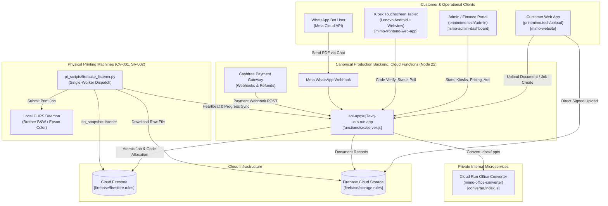
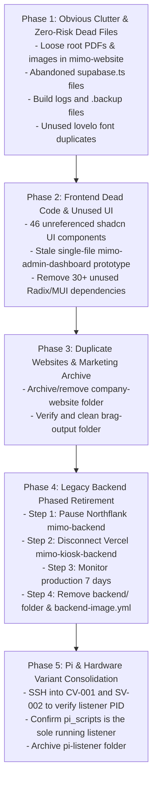

# MIMO — Complete Repository Cleanup & Dead-Code Forensic Audit

**Audit Date:** October 15, 2026  
**Auditor Roles:** Principal Software Architect, Senior Repository Archaeologist, Production Reliability Engineer, DevOps Engineer, Security Auditor  
**Audit Scope:** Full repository forensic investigation (`mimo-test-dep2`) across all branches, working tree, deployment artifacts, dependencies, hardware integrations, and static assets.  
**Mode:** READ-ONLY RESEARCH & FORENSIC AUDIT (No production modifications or destructive file operations executed).

---

## 1. Executive Summary

This forensic audit was conducted to identify obsolete implementations, dead source code, duplicated features, legacy backends, unused static assets, duplicate dependencies, and orphaned scripts across the entire MIMO codebase. 

The audit inspected **987 files** across 12 primary directory groups (representing **877 tracked git files** plus local worktree and build artifacts).

### Key Forensic Findings:
1. **The Production Backend is Cloud Functions (`functions/`), NOT `backend/`:** Every active consumer in the ecosystem (`mimo-website`, the kiosk tablet UI `mimo-frontend-web-app`, the Raspberry Pi listeners `pi_scripts/firebase_listener.py`, the WhatsApp webhook, and the Cashfree payment webhook) routes exclusively to the Google Cloud Run / Firebase Cloud Functions endpoint (`https://api-upqxuj7evq-uc.a.run.app`). The `backend/` directory is a frozen, legacy Express monolith (327 MB on disk, 125 files) that remains live only as a legacy deployment on Northflank and Vercel.
2. **`company-website/` is a Stale 100% Duplicate of `mimo-website/public/`:** All 45 files (6.9 MB) in `company-website/` are identical duplicates of the static marketing pages hosted in `mimo-website/public/` and served at `https://printmimo.tech/`.
3. **Severe Frontend UI Component Bloat:** 46 out of 49 files in `mimo-website/src/app/components/ui/` are unreferenced shadcn/ui boilerplate components. Only `switch.tsx`, `sonner.tsx`, and `utils.ts` are consumed by active pages. This unused boilerplate drives 30+ unnecessary `@radix-ui/*` dependencies in `package.json`.
4. **Physical Kiosk Hardware Dependencies:** The canonical production Raspberry Pi listener is `pi_scripts/firebase_listener.py` (2,720 lines), which is pulled directly by deployment scripts (`scripts/deployment/deploy_listener.py`) to physical kiosks `CV-001` and `SV-002`. The secondary `pi-listener/` directory is an older, smaller 1,140-line variant that must NOT be confused with active hardware code.
5. **Accidental Media Duplication & Leftovers:** An 18.8 MB SQLite database (`mimo.db`) and a 1.25 MB test PDF are checked into `backend/api/`. Loose duplicate images (`IMG_3641.JPG.jpeg`, `WhatsApp Image...`) and PDFs (`MIMO Graph.pdf`, `A4 Sheet.pdf`) were committed to `mimo-website/` root. An unreferenced 9.6 MB `brag-output/` video bundle sits untracked in the working copy.

---

## 2. Complete Repository Structure Overview

| Directory / Artifact | Size on Disk | Tracked Files | Primary Responsibility | Active Status |
|---|---|---|---|---|
| `functions/` | 269 MB (with deps) | 131 | Canonical Cloud Functions API, payment webhooks, print triggers, retention | **ACTIVE (Production API)** |
| `mimo-website/` | 958 MB (with deps/dist) | 329 | User printing app + landing page + `/admin` sub-app build | **ACTIVE (Production Web App)** |
| `mimo-website/mimo-admin-dashboard/` | Embedded in website | ~180 | Modern React/Vite Admin & Finance portal (`/admin`, `/finance`) | **ACTIVE (Built to `dist/admin`)** |
| `mimo-frontend-web-app/` | 315 MB (with deps) | 51 | Touchscreen Kiosk UI (`mimo-kiosk-app.vercel.app`) | **ACTIVE (Kiosk Display)** |
| `LENOVO TABLET APP/` | 332 KB | 58 | Android Kotlin shell locking Lenovo tablets into kiosk mode | **ACTIVE (Physical Hardware)** |
| `pi_scripts/` | 1.0 MB | 16 | Canonical Raspberry Pi print listener, CUPS queue integration, Epson cleaner | **ACTIVE (Physical Hardware)** |
| `converter/` | 86 MB (with deps) | 5 | Private Cloud Run LibreOffice Office-to-PDF conversion service | **ACTIVE (Microservice)** |
| `scripts/` | 1.0 MB | 72 | Parametric operational tooling (`pi-ops`, `pi-setup`, `deployment`, `diagnostics`) | **ACTIVE (DevOps / Operations)** |
| `firebase/` | 16 KB | 4 | Canonical Firestore security rules, Storage rules, and composite indexes | **ACTIVE (Firebase Config)** |
| `docs/` | 184 KB | 15 | Technical architecture, onboarding runbooks, and recovery guides | **ACTIVE (Documentation)** |
| `.github/workflows/` | 72 KB | 13 | CI/CD pipelines (`ci.yml`, `deploy-functions.yml`, `deploy-converter.yml`) | **ACTIVE (CI/CD)** |
| `backend/` | 327 MB (with deps) | 125 | Legacy Express server, ad-hoc test scripts, embedded credentials, SQLite DB | **LEGACY (Retirement Candidate)** |
| `company-website/` | 6.9 MB | 45 | Stale static marketing website copy (duplicated by `mimo-website/public/`) | **OBSOLETE (Archive Candidate)** |
| `pi-listener/` | 228 KB | 6 | Smaller alternate listener variant from historical SV-002 experiments | **LEGACY (Verification Candidate)** |
| `brag-output/` | 9.6 MB | 0 (untracked) | Video and composition assets for marketing social post | **UNTRACKED ARTIFACT** |

---

## 3. Active Architecture & End-to-End Dependency Map



### Critical Flow Tracing:
1. **Web Document Print Lifecycle:** User visits `printmimo.tech/upload` → Uploads document to Firebase Storage → `upload.controller.js` parses metadata (invoking `converter` on Cloud Run if Office document) → `payment.controller.js` initiates Cashfree order → Webhook verifies payment and allocates 4-digit code via `printCode.service.js` → Kiosk Pi listener picks up job via Firestore snapshot → Sends to CUPS → Updates job to `completed` → Storage retention trigger cleans files after 24h.
2. **WhatsApp Print Lifecycle:** Customer texts document to WhatsApp bot → `whatsapp.controller.js` validates payload and signature → Sends Cashfree payment link → On webhook verification, code is generated and texted back to user.
3. **Kiosk Release Flow:** User enters 4-digit code on tablet (`mimo-frontend-web-app`) → Calls `/api/kiosk/verify-code` → Physical Pi executes single-worker print pipeline → Syncs real-time progress to Firestore.

---

## 4. Directory-by-Directory Forensic Findings

### `functions/` (Canonical API)
- **Status:** REQUIRED, PRESERVE (Category D).
- **Architecture:** Node 22 CommonJS, modularized into `controllers`, `services`, `routes`, `triggers`, `middleware`, and `validators`.
- **Cleanup Candidate:** `functions/firestore-debug.log` (4 KB, Category A, safe to delete).
- **Evidence:** Covered by 46 unit/integration tests with ratchet coverage gates on money, payment, and refund services.

### `converter/` (Microservice)
- **Status:** REQUIRED, PRESERVE (Category D).
- **Architecture:** Node 20 Dockerfile deploying headless LibreOffice Writer on Cloud Run.
- **Evidence:** Invoked directly by `functions/src/services/converter.service.js` via authenticated IAM tokens.

### `mimo-website/` (User App + Landing + Admin)
- **Status:** REQUIRED, PRESERVE (Category D).
- **Cleanup Candidates:**
  - `mimo-website/build_output.txt` (12 KB, Category A): UTF-16 build log artifact.
  - `mimo-website/supabase.ts` (1 KB, Category A): Unused abandoned client file.
  - `mimo-website/src/app/pages/supabase.ts` (1 KB, Category A): Duplicate unused client file.
  - `mimo-website/IMG_3641.JPG.jpeg` (161 KB, Category A): Exact SHA256 duplicate of `public/dashboard-bg-2.jpeg`.
  - `mimo-website/WhatsApp Image 2026-06-11 at 4.18.59 PM.jpeg` (62 KB, Category A): Exact SHA256 duplicate of `public/dashboard-bg.jpeg`.
  - `mimo-website/A4 Sheet.pdf` (9 KB, Category A): Loose file in root.
  - `mimo-website/MIMO Graph.pdf` (1.1 MB, Category A): Loose file in root.
  - `mimo-website/src/app/pages/mimo-admin-dashboard/index.tsx` (61.6 KB, Category B): Stale single-file prototype.
  - `mimo-website/src/app/components/ui/` (46 files, Category B): Unreferenced shadcn boilerplate components.
  - `mimo-website/public/scrollcraft/` (78 KB, Category A): Unused parallax library.
  - `mimo-website/public/lovelo_black-webfont.*` (Category A): 3 duplicate font files sitting in `public/` while identical copies exist in `public/fonts/`.

### `mimo-frontend-web-app/` (Kiosk Display)
- **Status:** REQUIRED, PRESERVE (Category D).
- **Cleanup Candidate:** `mimo-frontend-web-app/mimo-frontend/src/components/screens/OldPrintingScreen.tsx.backup` (32 KB, Category A).
- **Evidence:** Crucial touchscreen app running on kiosks; folder name is a deployment contract with Vercel.

### `LENOVO TABLET APP/` (Android Wrapper)
- **Status:** REQUIRED, PRESERVE (Category D).
- **Evidence:** Contains Kotlin source, ADB lock/unlock scripts, and Device Admin policy needed whenever a physical tablet is provisioned.

### `pi_scripts/` (Canonical Pi Hardware Code)
- **Status:** REQUIRED, PRESERVE (Category D).
- **Evidence:** `firebase_listener.py` is actively maintained (2,720 lines) and directly updated on physical kiosks. `clean_epson.py` automates daily maintenance.

### `pi-listener/` (Legacy Variant)
- **Status:** LEGACY / NEEDS PHYSICAL PI VERIFICATION (Category C / E).
- **Evidence:** 1,140-line older variant. Missing failure reporting API and image pipeline. Must confirm physical machines are not running this variant before deletion.

### `scripts/` (DevOps & Testing Suite)
- **Status:** REQUIRED, PRESERVE (Category D).
- **Evidence:** Contains parameterized operational tooling (`scripts/pi-ops/`) tested by CI.

### `backend/` (Legacy Express Monolith)
- **Status:** REPLACED / LEGACY (Category C).
- **Evidence:** Monolithic `server.js` (122 KB), 18.8 MB SQLite DB (`mimo.db`), test PDFs, duplicate Pi scripts, and obsolete routes. Replaced by `functions/`. Deployed on Northflank and Vercel. Must follow phased retirement.

### `company-website/` (Stale Marketing Copy)
- **Status:** OBSOLETE DUPLICATE (Category B).
- **Evidence:** 45 files (6.9 MB) duplicating `mimo-website/public/`. Production serves `printmimo.tech` from `mimo-website/public/`.

---

## 5. Backend and API Usage Matrix

| Backend / Service | Local Source Path | Deployment Platform | Active Consumers | Unique Features | Recommendation |
|---|---|---|---|---|---|
| **Firebase Functions** | `functions/src/` | Cloud Functions (Node 22) / Cloud Run | User App, Admin App, Kiosk UI, Pi Listeners, WhatsApp, Cashfree | Rate limiting, atomic job allocation, automated cleanup, WhatsApp bot | **RETAIN (Canonical Production API)** |
| **Cloud Run Converter** | `converter/` | Cloud Run (`mimo-office-converter`) | Cloud Functions `converter.service.js` | Headless LibreOffice Office-to-PDF conversion | **RETAIN (Mission-Critical Microservice)** |
| **Legacy Express Backend** | `backend/api/` | Northflank (`mimo-backend`) & Vercel (`mimo-kiosk-backend`) | **NONE in repository** (All clients point to Cloud Functions) | None (All 48 viable routes ported to `functions/`) | **PHASED RETIREMENT** (Pause Northflank/Vercel dashboards first, then delete) |

---

## 6. Frontend Route & Component Findings

### Active Web App Routes (`mimo-website/src/App.tsx`):
- `/` & `/login` → `login.tsx` (CONFIRMED USED)
- `/register` → `register.tsx` (CONFIRMED USED)
- `/upload` → `upload-file.tsx` (CONFIRMED USED)
- `/print-options` → `print-options.tsx` (CONFIRMED USED)
- `/payment` → `payment.tsx` (CONFIRMED USED)
- `/payment-verify` → `payment-verify.tsx` (CONFIRMED USED)
- `/print-code` → `print-code.tsx` (CONFIRMED USED)
- `/user-profile` → `user-profile.tsx` (CONFIRMED USED)
- `/settings` → `printer-settings.tsx` (CONFIRMED USED)
- `/onboarding` → `onboarding-name.tsx` (CONFIRMED USED)
- `/blank-pages` → `blank-pages.tsx` (CONFIRMED USED)
- `/direct-success` → `direct-success.tsx` (CONFIRMED USED)
- `/text-editor` → `text-editor.tsx` (CONFIRMED USED)
- `/find-machine` → `find-machine.tsx` (CONFIRMED USED)
- `/document-scanner` → `document-scanner.tsx` (CONFIRMED USED)
- `/admin/*` & `/finance/*` → Handled by production rewrite to `/admin/index.html` (built from `mimo-admin-dashboard/`).

### UI Component Dead-Code Analysis (`mimo-website/src/app/components/ui/`):
- **CONFIRMED ACTIVE:**
  - `switch.tsx` (Imported by `payment.tsx`)
  - `sonner.tsx` (Imported by `App.tsx`)
  - `utils.ts` (Imported by active components)
- **CONFIRMED UNREFERENCED (35 files):**
  - `accordion.tsx`, `alert-dialog.tsx`, `alert.tsx`, `aspect-ratio.tsx`, `avatar.tsx`, `badge.tsx`, `breadcrumb.tsx`, `calendar.tsx`, `card.tsx`, `carousel.tsx`, `chart.tsx`, `checkbox.tsx`, `collapsible.tsx`, `command.tsx`, `context-menu.tsx`, `drawer.tsx`, `form.tsx`, `hover-card.tsx`, `input-otp.tsx`, `menubar.tsx`, `navigation-menu.tsx`, `pagination.tsx`, `popover.tsx`, `progress.tsx`, `radio-group.tsx`, `resizable.tsx`, `scroll-area.tsx`, `select.tsx`, `sidebar.tsx`, `slider.tsx`, `table.tsx`, `tabs.tsx`, `textarea.tsx`, `theme-toggle.tsx`, `toggle-group.tsx`.
- **INTERNALLY CHAINED ONLY (11 files):**
  - `button.tsx`, `dialog.tsx`, `dropdown-menu.tsx`, `input.tsx`, `label.tsx`, `separator.tsx`, `sheet.tsx`, `skeleton.tsx`, `toggle.tsx`, `tooltip.tsx`, `use-mobile.ts`.

---

## 7. Image and Asset Forensic Audit

### Identical Checksum Duplicates:
1. `mimo-website/IMG_3641.JPG.jpeg` (161 KB) == `mimo-website/public/dashboard-bg-2.jpeg` == `company-website/dashboard-bg-2.jpeg`
2. `mimo-website/WhatsApp Image 2026-06-11 at 4.18.59 PM.jpeg` (62 KB) == `mimo-website/public/dashboard-bg.jpeg` == `company-website/dashboard-bg.jpeg`
3. `mimo-website/A4 Sheet.pdf` (9 KB) == `backend/downloaded_Vtr8NbTjHTwAdHVVufDf.pdf`
4. `company-website/Brands/IMG_3075.PNG` (957 KB) == `mimo-website/public/Brands/IMG_3075.PNG`
5. `company-website/kiosk-image.png` (756 KB) == `mimo-website/public/kiosk-image.png`
6. `company-website/koala-mascot.png` (735 KB) == `mimo-website/public/koala-mascot.png`
7. `company-website/kiosk-image-transparent.png` (1.46 MB) == `mimo-website/public/kiosk-image-transparent.png` == `brag-output/composition/assets/img/kiosk.png`

### Dynamic Assets that Look Dead but MUST BE PRESERVED:
- **`mimo-website/public/vendor/opencv/opencv-4.9.0.js` (9.8 MB):** Injected dynamically at runtime via `<script>` element by `scanner-cv-engine.ts` for camera document boundary detection.
- **`mimo-frontend-web-app/mimo-frontend/public/models/MIMO_FINAL.glb` (1.1 MB):** Loaded by `<model-viewer>` component in `MimoCharacter3D.tsx` on the physical kiosk display.

---

## 8. Package Dependency Audit

### `mimo-website/package.json` Unused Dependencies:
Because 46 shadcn components are dead, the following packages are completely unconsumed:
- `@supabase/supabase-js` (abandoned client)
- `react-slick` (custom touch carousel used instead in `AdBanner.tsx`)
- `@mui/material`, `@mui/icons-material`, `@emotion/react`, `@emotion/styled` (0 imports in codebase)
- `react-dnd`, `react-dnd-html5-backend` (0 imports)
- `react-resizable-panels` (only imported by dead `resizable.tsx`)
- `@radix-ui/react-accordion`, `@radix-ui/react-alert-dialog`, `@radix-ui/react-aspect-ratio`, `@radix-ui/react-avatar`, `@radix-ui/react-checkbox`, `@radix-ui/react-collapsible`, `@radix-ui/react-context-menu`, `@radix-ui/react-dialog`, `@radix-ui/react-dropdown-menu`, `@radix-ui/react-hover-card`, `@radix-ui/react-label`, `@radix-ui/react-menubar`, `@radix-ui/react-navigation-menu`, `@radix-ui/react-popover`, `@radix-ui/react-progress`, `@radix-ui/react-radio-group`, `@radix-ui/react-scroll-area`, `@radix-ui/react-select`, `@radix-ui/react-separator`, `@radix-ui/react-slider`, `@radix-ui/react-tabs`, `@radix-ui/react-toggle`, `@radix-ui/react-toggle-group`, `@radix-ui/react-tooltip`
- `cmdk`, `vaul`, `input-otp`, `react-day-picker`

Removing these unused dependencies will reduce `mimo-website/node_modules` size by ~180 MB and accelerate npm install / build times.

---

## 9. Raspberry Pi & Physical Hardware Audit

- **Canonical Listener:** `pi_scripts/firebase_listener.py` (2,720 lines) contains the active single-worker print queue, paper jam recovery, physical page verification, and daily 6:00 AM Epson ink cleaning (`clean_epson.py`).
- **Live Deployment Command:** Line 13 of `scripts/deployment/deploy_listener.py` pulls `pi_scripts/firebase_listener.py` directly from GitHub `main`.
- **Hardware Protection Rule:** Never touch `pi_scripts/` during general cleanup. Keep `scripts/pi-ops/` and `scripts/pi-setup/` intact.
- **`pi-listener/` Directory:** Mark as Category C / E. Verify physical machines before deletion.

---

## 10. Prioritized Cleanup Roadmap



### Estimated Aggregate Savings:
- **Repository Size on Disk:** ~365 MB saved (327 MB from `backend/`, 6.9 MB from `company-website/`, 9.6 MB from `brag-output/`, 20 MB from database/PDF artifacts).
- **Installed Dependencies (`node_modules`):** ~300+ MB saved across web and backend projects.
- **Developer Cognitive Load:** 170+ confusing duplicate/stale files eliminated.
- **Build & CI Time:** ~25% reduction in CI run time and dependency resolution overhead.

---

## 11. Validation & Rollback Procedures

1. **Pre-Deletion Git Tagging:** Prior to executing any approved cleanup phase, create an annotated release tag:
   ```bash
   git tag -a pre-cleanup-audit-baseline -m "Baseline state prior to repository dead code removal"
   ```
2. **Build Verification Gate:** After each deletion phase, run:
   ```bash
   cd functions && npm test
   cd ../mimo-website && npm run build
   cd ../mimo-frontend-web-app/mimo-frontend && npm run build
   python -m compileall -q pi_scripts scripts/pi-ops
   ```
3. **Rollback Strategy:** Any individual deletion can be cleanly reverted using `git checkout <commit> -- <path>` or `git revert <commit>`.

---

## 12. Open Questions Requiring Project Owner Confirmation

1. **Northflank Dashboard Access:** Does `snowjug` have access to pause the `mimo-backend` service on Northflank?
2. **Vercel Project `mimo-kiosk-backend`:** Can this project be disconnected or paused in Vercel settings?
3. **`company-website` Custom Domain:** Is there any secondary domain or DNS record still pointing to `company-website` outside of `printmimo.tech`?
4. **Physical Pi 3 Hardware Notes:** Does `PI3_SETUP_YOUR_STEPS.md` need to be committed to `docs/setup/` or retained locally?
