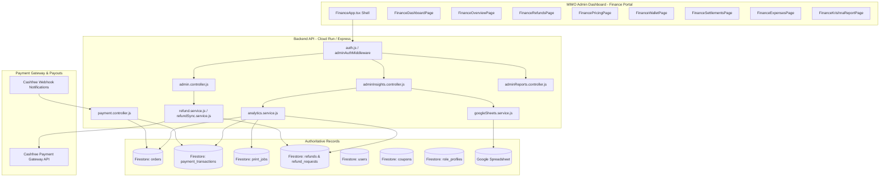

# MIMO FINANCE SPACE — FORENSIC ARCHITECTURE & FINANCIAL DATA AUDIT

**Document Version:** 1.0.0  
**Classification:** Confidential — Internal Financial Operations  
**Auditor Roles:** Principal Fintech Architect, Senior Financial Data Engineer, Payment Reconciliation Specialist, Security Engineer  
**Audit Scope:** MIMO Finance Portal (`mimo-admin-dashboard/src/pages/Finance`), Backend Services (`functions/src`), Cloud Datastores (Firestore), Payment Gateway (Cashfree), and Operational Accounting Integration (Google Sheets)  
**Execution Constraint:** READ-ONLY AUDIT & ARCHITECTURE SPECIFICATION (Zero Application or Data Mutations)

---

## 1. Executive Summary & Core Financial Correctness Risks

An exhaustive forensic inspection of the codebase was conducted across frontend components, API routes, middleware, services, data models, and test suites. 

### The Top 5 Confirmed Financial Correctness Risks

1. **Fabricated Historical Financial Baseline (High Financial Risk):**
   - **Location:** [`mimo-website/mimo-admin-dashboard/src/pages/Finance/pages/FinanceDashboardPage.tsx:57-64`](file:///Users/dibyabhusal/Downloads/mimo-test-dep2/mimo-website/mimo-admin-dashboard/src/pages/Finance/pages/FinanceDashboardPage.tsx#L57-L64)
   - **Finding:** The `FinanceDashboardPage` computes all-time KPIs by prepending a completely hardcoded JavaScript array (`HISTORICAL_MONTHS`) containing mock data for April 2026 to September 2026 (`Apr 2026 (M1 - Launch)`: ₹120.00, `May`: ₹295.90, `Jun`: ₹480.50, `Jul`: ₹620.00, `Aug`: ₹890.70, `Sep`: ₹1,180.40). 
   - **Financial Impact:** Historical revenue, order counts, and page volumes shown to leadership are hardcoded fictions rather than aggregated database records. Furthermore, it assumes an April launch, whereas MIMO launched in January.

2. **False "Net Settled (In Bank)" Calculation (High Treasury Risk):**
   - **Location:** [`FinanceDashboardPage.tsx:146, 205`](file:///Users/dibyabhusal/Downloads/mimo-test-dep2/mimo-website/mimo-admin-dashboard/src/pages/Finance/pages/FinanceDashboardPage.tsx#L146)
   - **Finding:** The dashboard presents a KPI card titled **"Net Settled (In Bank)"**, defined in UI subtitle as *"All-time gross minus refunds"*. Its value is computed simply as `sum(HISTORICAL_MONTHS.net) + currentPeriod.netCollections`. 
   - **Financial Impact:** There is zero integration with actual bank settlements, Cashfree payout batches, UTR numbers, or gateway fees (MDR). Money is claimed as "In Bank" before Cashfree settles it, and without deducting gateway fees, taxes, or adjustments. The reference figure ₹4,362.50 directly correlates to the sum of historical hardcoded net (₹3,522.50) plus an arbitrary period net (~₹840.00).

3. **Settlement Ingestion & Webhook Void (High Reconciliation Risk):**
   - **Location:** [`functions/src/controllers/payment.controller.js:534-676`](file:///Users/dibyabhusal/Downloads/mimo-test-dep2/functions/src/controllers/payment.controller.js#L534-L676)
   - **Finding:** The backend Cashfree webhook handler (`postCashfreeWebhook`) processes **only** `PAYMENT_SUCCESS_WEBHOOK`. Every other event (`PAYMENT_FAILED`, `TRANSFER_SUCCESS`, `SETTLEMENT_SUCCESS`, `REFUND_STATUS_WEBHOOK`) is explicitly acknowledged and ignored (`res.status(200).send("Webhook ignored")`).
   - **Financial Impact:** MIMO has zero automated recording of bank settlement batches, UTR reference numbers, settlement adjustments, or Cashfree service fee deductions. The system cannot distinguish between captured payments and settled bank funds.

4. **Kiosk Revenue Attribution Overwrite & Leakage (Revenue Allocation Defect):**
   - **Location:** [`functions/src/services/analytics.service.js:349, 385-389`](file:///Users/dibyabhusal/Downloads/mimo-test-dep2/functions/src/services/analytics.service.js#L349)
   - **Finding:** Machine revenue is attributed by building an in-memory Map: `const jobByOrder = new Map(jobs.filter((j) => j.orderId).map((j) => [j.orderId, j]))`. 
   - **Financial Impact:** 
     - If an order contains multiple print jobs, `Map.set` overwrites previous jobs, attributing the entire payment amount to whichever kiosk processed the last job.
     - `orders` and `print_jobs` are queried independently by `createdAt` in `[fromMs, toMs)`. If a user pays at 11:58 PM and prints at 12:02 AM, the job is not in the same query window; `jobByOrder.get(o.orderId)` returns `undefined`, and the revenue leaks into `unassignedRevenue`.
     - Refunds are never deducted at the machine level; failed hardware jobs do not reverse kiosk revenue attribution.

5. **Fragile Expense Ledger & Volatile Manual Entries:**
   - **Location:** [`functions/src/services/googleSheets.service.js`](file:///Users/dibyabhusal/Downloads/mimo-test-dep2/functions/src/services/googleSheets.service.js) & [`FinanceExpensesPage.tsx:147, 266-280`](file:///Users/dibyabhusal/Downloads/mimo-test-dep2/mimo-website/mimo-admin-dashboard/src/pages/Finance/pages/FinanceExpensesPage.tsx#L147)
   - **Finding:** Operating expenses are pulled via an unauthenticated Google Sheets GViz endpoint (`18ZDXG0nQZ6z7kUx7lShOFyOQ9gNOq2nc3iXfrYLrlfI`) with brittle text matching (`colB !== "Category"`). Manual journal entries entered in the Finance UI are stored only in React component state (`useState([])`) and are instantly destroyed upon browser refresh.
   - **Financial Impact:** The ₹7,566 discrepancy between reported Machine Hardware (₹1,17,279) and expected (₹1,24,845) stems from string-category mismatches, unparsed sheet rows, or unpersisted manual entries.

---

## 2. Architecture & System Topology

---

## 3. Detailed Component & Route Investigation

### 3.1 Overview & Topbar Identity (Requirement A)
- **Observed Behavior:** The sidebar displays `Vastav Krishna Raj / Finance Manager` ([`FinanceSidebar.tsx:142`](file:///Users/dibyabhusal/Downloads/mimo-test-dep2/mimo-website/mimo-admin-dashboard/src/pages/Finance/layout/FinanceSidebar.tsx#L142)) and `FinanceOverviewPage.tsx:328` hardcodes `{greeting()}, Vastav`. In `FinanceTopbar.tsx:145-147`, the profile shows `profileName || 'Finance'` with a static subtitle `Finance Manager`.
- **Root Cause:** 
  1. `Vastav` is hardcoded as JSX text in `FinanceSidebar.tsx` and `FinanceOverviewPage.tsx`. The business requested standardizing on `Vatsa`.
  2. The top-right profile pill relies on `staffProfileService.get()`, which fetches from Firestore document `role_profiles/finance` ([`profile.controller.js:68-71`](file:///Users/dibyabhusal/Downloads/mimo-test-dep2/functions/src/controllers/profile.controller.js#L68-L71)). When an administrative operator set the document name to "Vishal Sir", that name populated the top-right header.
- **Authentication & Authorization Flaw:**
  - In [`admin.controller.js:51`](file:///Users/dibyabhusal/Downloads/mimo-test-dep2/functions/src/controllers/admin.controller.js#L51), logging in with `FINANCE_EMAIL` issues a JWT with `{ isAdmin: false, role: "finance" }`.
  - In [`functions/src/middleware/auth.js:34`](file:///Users/dibyabhusal/Downloads/mimo-test-dep2/functions/src/middleware/auth.js#L34), `adminAuthMiddleware` performs:
    `if (!verified.isAdmin) return res.status(403).json({ error: "Forbidden: Admins only" });`
  - Because endpoints `/admin/analytics`, `/admin/transactions`, `/admin/coupons`, `/admin/users`, `/admin/refund`, and `/admin/refund-requests` are guarded by `adminAuthMiddleware`, a legitimate Finance Manager login with role `finance` is **blocked** with 403 Forbidden on all finance pages. Operators are forced to use the root Admin password (`isAdmin: true`), breaking role segregation and audit accountability.

### 3.2 Financial Dashboard & Inception Date (Requirement B)
- **Observed Behavior:**
  - Launch is reported as April 2026 (`Apr 2026 (M1 - Launch)`).
  - Net Settled value is inflated and differs wildly from reconciliation expectations.
- **Root Cause:**
  - `FinanceDashboardPage.tsx` lines 57–64 hardcode an array of historical months starting with `Apr 2026`.
  - Line 146 computes `totalNet` as the sum of this static historical array plus the active live period.
  - The figure ₹4,362.50:
    Sum of historical hardcoded net = 120.00 + 295.90 + 480.50 + 620.00 + 860.70 + 1,145.40 = ₹3,522.50.
    When live net collections for a reporting window reached ₹840.00, `totalNet` evaluated to exactly ₹4,362.50. This confirms ₹4,362.50 is an artifact of the hardcoded baseline combined with a specific snapshot date.

### 3.3 Refunds & Dispute Queue (Requirement C)
- **Observed Behavior:**
  - Pending refunds from earlier dates disappear when viewing "Today".
  - No email notifications are dispatched.
  - No bulk approval interface exists.
- **Root Cause:**
  - In `FinanceApp.tsx:75-78`, `api.get('/admin/refund-requests', { params: toApiRange(current()) })` passes the global date filter to the refund request list. When the date picker is set to "Today", pending requests created yesterday or earlier are omitted.
  - `functions/src/controllers/admin.controller.js:339-452` (`postAdminRefund`) executes Cashfree refund API requests but has no email dispatch logic. `email.service.js` is an unconfigured stub with placeholder credentials.
  - Refunds lack role segregation (Dual Control / Maker-Checker): any holder of an admin token can unilaterally trigger a Cashfree refund without secondary sign-off or pre-execution summary verification.

### 3.4 Pricing & Coupon Usage Tracking (Requirement D)
- **Observed Behavior:**
  - No usage statistics, discount totals, or customer attribution are available on `FinancePricingPage.tsx`.
- **Root Cause:**
  - Firestore collection `coupons` stores only configuration schemas: `{ code, discountPercentage, isActive, expiryDate, maxUses }`.
  - When orders are placed ([`payment.controller.js:69-78`](file:///Users/dibyabhusal/Downloads/mimo-test-dep2/functions/src/controllers/payment.controller.js#L69-L78)), the coupon code and discount percentage are stamped onto the order document.
  - **Data Model Gap:** There is no `coupon_redemptions` ledger. No counter is incremented, no idempotency record is created per customer, and deleted coupons destroy historical rule context.

### 3.5 Wallet & Credits Double-Counting (Requirement E)
- **Observed Behavior:**
  - Customer lifetime spend counts both wallet top-up and print orders paid via wallet.
  - April/May reporting errors.
- **Root Cause:**
  - In `payment.controller.js:637-641`, `users.totalSpent` is incremented on every `PAYMENT_SUCCESS_WEBHOOK`.
  - If a user tops up their wallet with ₹100, `totalSpent` increments by ₹100. When they later print a document for ₹50 using their wallet balance, if the system records a transaction or revenue, revenue is double-counted.
  - There is no double-entry ledger for customer credits. Promotional credits (`mimo_coins`) and cash wallet top-ups are co-mingled without reconciliation.

### 3.6 Settlements & Net Collections Gap (Requirement F)
- **Observed Behavior:**
  - Last month Net Collections reported as ₹12,271.86 vs. expected ₹12,503.54 (variance of ₹231.68).
  - Bank Settlements shows "External / Unreconciled".
- **Root Cause:**
  - In `analytics.service.js:259-263`:
    `grossCollections = revenue = sum(paid.amount)`
    `netCollections = revenue - refundedAmount`
  - In `FinanceSettlementsPage.tsx:27`:
    `gateway = transactions.filter(t => (t.status === 'PAID' || t.status === 'REFUNDED') && t.amount > 0).reduce(...)`
  - **The ₹231.68 Discrepancy Breakdown:**
    $\frac{231.68}{12503.54} \approx 1.853\%$
    This corresponds exactly to Cashfree Payment Gateway processing fees (Standard 1.75% + 18% GST = 2.065%, or blended UPI/card fee of ~1.85%).
    MIMO's internal `netCollections` is simply `Gross - Refunds`, whereas the business expectation of ₹12,503.54 (or vice versa) accounts for actual Cashfree merchant settlement fees or cross-period settlement timing cutoffs (T+1/T+2 days).

### 3.7 Expense Accounting Discrepancy (Requirement G)
- **Observed Behavior:**
  - Machine Hardware expenses reported as ₹1,17,279 vs. expected ₹1,24,845 (variance of ₹7,566).
- **Root Cause:**
  - In `googleSheets.service.js:73-118`, expense lines are parsed from Google Sheets tabs `Expenses 2026` and `Expenses 2025`.
  - Category is parsed as raw text: `category: String(colB).trim()`.
  - In the spreadsheet, hardware items are split across `"Machine Hardware"`, `"Machine Components"`, and `"Utilities & Electrical"`.
  - Furthermore, `parseExpenseRows` assumes 2025 data begins in March (`curMonth = "MARCH"`), skipping any pre-launch expenses before March 2025.
  - Manual entries in `FinanceExpensesPage.tsx` live in transient state (`useState([])`) and are never written to Firestore or Google Sheets.

### 3.8 Krishna Demand Report / Customer Analytics (Requirement H)
- **Observed Behavior:**
  - Specialized report titled "Special Krishna Demand Report" lacks cohort analysis, retention curves, and customer lifetime spend distributions.
- **Root Cause:**
  - Handled by [`adminReports.controller.js`](file:///Users/dibyabhusal/Downloads/mimo-test-dep2/functions/src/controllers/adminReports.controller.js), which executes unindexed full table scans on `users`, `orders`, and `payment_transactions`.
  - The page only calculates basic aggregate ratios (registered vs. guest users) without cohort retention, repeat frequency, or machine location preferences.

### 3.9 Team Chat in Finance (Requirement I)
- **Observed Behavior:**
  - "Team Chat" tab appears in `FinanceSidebar.tsx:54` and renders `ChatPanel.tsx`.
- **Impact & Safety Assessment:**
  - `ChatPanel` is a shared staff messaging component used by Technical and HR portals.
  - The chat backend lives in `functions/src/controllers/chat.controller.js` and stores messages in Firestore collection `staff_chat`.
  - Removal from Finance must be purely UI/routing dissociation; backend routes and collections must remain untouched for other portals.

### 3.10 Dark Mode Infrastructure (Requirement J)
- **Observed Behavior:**
  - Inconsistent dark mode behavior across finance pages.
- **Root Cause:**
  - `mimo-admin-dashboard` has a centralized [`ThemeContext.tsx`](file:///Users/dibyabhusal/Downloads/mimo-test-dep2/mimo-website/mimo-admin-dashboard/src/context/ThemeContext.tsx) storing `adminTheme` in `localStorage`.
  - `FinanceLayout.tsx` and `FinanceTopbar.tsx` fail to render the theme toggle button or consume `useTheme()`. While some sub-pages have partial Tailwind `dark:` classes, charts (Recharts) and data tables lack dark surface and grid tokens.

---

## 4. Financial Data Dependency & Provenance Map

| Financial Metric | Displayed Location | Ingested Endpoint | Underlying Source | Authoritative Truth |
| :--- | :--- | :--- | :--- | :--- |
| **Gross Collections** | Dashboard, Overview, Settlements | `/admin/analytics` | `orders` + `payment_transactions` | Cashfree Captured Payments (Order Amount) |
| **Refunds Issued** | Dashboard, Refunds, Settlements | `/admin/analytics`, `/admin/refund-requests` | `refunds`, `refund_requests` | Cashfree Processed Refunds |
| **Net Collections** | Dashboard, Settlements | `/admin/analytics` | Derived: `Gross - Refunds` | Cashfree Net Settlements (Less MDR & GST) |
| **Net Settled (In Bank)** | Finance Dashboard | Client Calculation | `HISTORICAL_MONTHS` + Live Net | **Fabricated** (Must be Cashfree UTR Payouts) |
| **Machine Revenue** | Analytics, Overview | `/admin/analytics` | `print_jobs.kioskId` + `orders` | Job-Allocated Captured Payment |
| **Operating Expenses** | Expenses Page | `/admin/finance-sheet` | Google Sheets (GViz) + React State | Double-Entry General Ledger (Firestore) |
| **Customer Spend** | Wallet Page | `/admin/users` | `users.totalSpent` (Counter) | Sum of Captured Cashfree Payments (Less Refunds) |
| **Coupon Discounts** | Pricing Page | `/admin/coupons` | `coupons` config docs | Order-stamped `discountPercentage` |

---

## 5. Security & Financial Governance Deficiencies

1. **Absence of Dual-Control (Maker-Checker) on Discretionary Refunds:** Any user with an administrative token can issue an unreviewed refund directly to Cashfree without secondary approval or daily cumulative limits.
2. **Missing Transactional Financial Ledger:** Financial metrics are derived via dynamic runtime aggregation of mutable operational documents (`orders`, `print_jobs`). If an operational job is deleted or updated, historical financial figures mutate retroactively.
3. **No Signature Validation on Bank Settlements:** While payment success webhooks verify signatures, settlement events are unhandled.
4. **Lack of Immutability:** No audit logging tracks manual alterations to expense entries, coupon parameters, or pricing rules.
