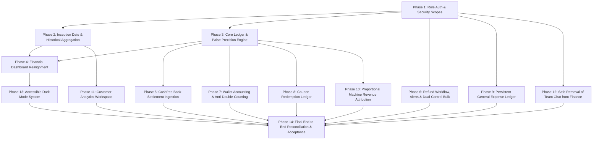

# MIMO FINANCE SPACE — PRODUCTION IMPLEMENTATION PLAN

**Document Version:** 1.0.0  
**Methodology:** Dependency-Aware Phase-Gated Engineering  
**Quality Bar:** Zero Production Downtime, Backward-Compatible Datastore Migrations, Audit-Trail Preserved  
**Target Branch:** `feature/finance-production-reconciliation` (To be created upon approval)

---

## 1. Master Phase Sequence & Dependency Graph

---

## 2. Detailed Phase Specifications

### Phase 1 — Role Authentication & Security Scopes
- **Objective:** Enable legitimate Finance Manager logins with role `finance` to access finance APIs without demanding root `isAdmin: true`.
- **Prerequisites:** None.
- **Deliverables:**
  - Create `financeOrAdminAuthMiddleware` supporting both `isAdmin: true` and `role: "finance"`.
  - Apply middleware across `/admin/analytics`, `/admin/transactions`, `/admin/refund-requests`, `/admin/coupons`, `/admin/users`.
  - Standardize workspace branding constant to `Vatsa` in place of hardcoded `Vastav`.
  - Audit `role_profiles/finance` document to ensure display name reflects authorized personnel.
- **Impacted Files:**
  - [`functions/src/middleware/auth.js`](file:///Users/dibyabhusal/Downloads/mimo-test-dep2/functions/src/middleware/auth.js)
  - [`functions/src/routes/admin.routes.js`](file:///Users/dibyabhusal/Downloads/mimo-test-dep2/functions/src/routes/admin.routes.js)
  - [`FinanceSidebar.tsx`](file:///Users/dibyabhusal/Downloads/mimo-test-dep2/mimo-website/mimo-admin-dashboard/src/pages/Finance/layout/FinanceSidebar.tsx)
  - [`FinanceOverviewPage.tsx`](file:///Users/dibyabhusal/Downloads/mimo-test-dep2/mimo-website/mimo-admin-dashboard/src/pages/Finance/pages/FinanceOverviewPage.tsx)
- **Database Changes:** None.
- **Tests:** Unit test `financeOrAdminAuthMiddleware` with Admin JWT, Finance JWT, and unauthorized JWT.
- **Rollback Strategy:** Revert route middleware to previous exports.

---

### Phase 2 — Inception Date & Dynamic Historical Aggregation
- **Objective:** Eliminate the hardcoded `HISTORICAL_MONTHS` array and anchor reporting to MIMO's actual January 2026 launch.
- **Prerequisites:** Phase 1.
- **Deliverables:**
  - Delete `HISTORICAL_MONTHS` mock array in `FinanceDashboardPage.tsx`.
  - Create backend aggregation endpoint `GET /admin/analytics/monthly-summary` that queries Firestore `orders` and `payment_transactions` starting from `2026-01-01T00:00:00+05:30`.
  - Group transactions into calendar months using IST offset (`+330` minutes).
- **Impacted Files:**
  - [`functions/src/services/analytics.service.js`](file:///Users/dibyabhusal/Downloads/mimo-test-dep2/functions/src/services/analytics.service.js)
  - [`functions/src/controllers/adminInsights.controller.js`](file:///Users/dibyabhusal/Downloads/mimo-test-dep2/functions/src/controllers/adminInsights.controller.js)
  - [`FinanceDashboardPage.tsx`](file:///Users/dibyabhusal/Downloads/mimo-test-dep2/mimo-website/mimo-admin-dashboard/src/pages/Finance/pages/FinanceDashboardPage.tsx)
- **Database Changes:** Composite Firestore index on `orders` (`createdAt` ASC, `status` ASC).
- **Tests:** Verify monthly totals from January 2026 to present match raw transaction sums.
- **Rollback Strategy:** Feature flag `USE_DYNAMIC_MONTHLY_HISTORY` fallback.

---

### Phase 3 — Core Ledger & Paise Minor-Unit Engine
- **Objective:** Eliminate floating-point calculation drift across all financial calculations.
- **Prerequisites:** Phase 1.
- **Deliverables:**
  - Introduce `Money` utility class in backend and frontend executing strict integer paise math.
  - Standardize financial rounding on Banker's Rounding (Round half to even).
- **Impacted Files:**
  - `functions/src/utils/money.js` (New)
  - `mimo-admin-dashboard/src/lib/format.ts`
  - [`analytics.service.js`](file:///Users/dibyabhusal/Downloads/mimo-test-dep2/functions/src/services/analytics.service.js)
- **Tests:** Unit tests with 10,000 randomized fractional amounts verifying $\sum \text{Allocations} = \text{Total}$ without 1-paisa leak.

---

### Phase 4 — Financial Dashboard Realignment
- **Objective:** Disclose true reconciliation status and decouple Gross Collections from Bank Settlement.
- **Prerequisites:** Phases 2 & 3.
- **Deliverables:**
  - Retitle KPI cards to **Gross Collections (Order Value)**, **Completed Customer Refunds**, and **Net Collections (Operating Balance)**.
  - Add **Bank Settlements (Payouts)** card with clear state indicator: `Reconciled` vs. `Awaiting Cashfree Batch`.
  - Link each KPI card directly to its granular drill-down tab (Transactions, Refunds, Settlements).
- **Impacted Files:**
  - [`FinanceDashboardPage.tsx`](file:///Users/dibyabhusal/Downloads/mimo-test-dep2/mimo-website/mimo-admin-dashboard/src/pages/Finance/pages/FinanceDashboardPage.tsx)
  - `FinanceMetricCard.tsx`
- **Acceptance Criteria:** Zero hardcoded financial numbers; drill-down destinations correctly filter by the dashboard's active period.

---

### Phase 5 — Cashfree Bank Settlement Ingestion
- **Objective:** Ingest actual Cashfree bank payout batches, UTR numbers, and gateway fees (MDR).
- **Prerequisites:** Phase 3, Cashfree Merchant Credentials.
- **Deliverables:**
  - Implement webhook listener for `SETTLEMENT_SUCCESS` and `TRANSFER_SUCCESS` in `payment.controller.js`.
  - Implement HMAC-SHA256 binary signature verification with 300s timestamp window check.
  - Store settlement batches in Firestore `cashfree_settlements`.
  - Update `FinanceSettlementsPage.tsx` to display UTR numbers, gross batch amount, MDR fees deducted, and net bank credit.
- **Impacted Files:**
  - [`functions/src/controllers/payment.controller.js`](file:///Users/dibyabhusal/Downloads/mimo-test-dep2/functions/src/controllers/payment.controller.js)
  - [`functions/src/routes/payment.routes.js`](file:///Users/dibyabhusal/Downloads/mimo-test-dep2/functions/src/routes/payment.routes.js)
  - [`FinanceSettlementsPage.tsx`](file:///Users/dibyabhusal/Downloads/mimo-test-dep2/mimo-website/mimo-admin-dashboard/src/pages/Finance/pages/FinanceSettlementsPage.tsx)
- **Database Changes:** New collection `cashfree_settlements` with index on `settledAt` DESC.
- **Tests:** Mock webhook delivery with valid and invalid signatures, duplicate webhook delivery, and fee arithmetic verification.
- **Rollback Strategy:** Webhook route feature toggle.

---

### Phase 6 — Refund Workflow, Email Alerts & Dual-Control Bulk Approvals
- **Objective:** Build an enterprise refund queue withMaker-Checker bulk processing and automated audit alerts.
- **Prerequisites:** Phase 1.
- **Deliverables:**
  - Update `getAdminRefundRequests` to return all pending refunds regardless of creation date.
  - Implement bulk approval endpoint `POST /admin/refunds/bulk-approve` with transaction-level claim locks.
  - Frontend multi-select table showing total selected refund amount and affected orders before confirmation.
  - Configure production email service (SendGrid / AWS SES) to dispatch notification on refund submission.
- **Impacted Files:**
  - [`functions/src/controllers/admin.controller.js`](file:///Users/dibyabhusal/Downloads/mimo-test-dep2/functions/src/controllers/admin.controller.js)
  - [`functions/src/services/email.service.js`](file:///Users/dibyabhusal/Downloads/mimo-test-dep2/functions/src/services/email.service.js)
  - [`FinanceRefundsPage.tsx`](file:///Users/dibyabhusal/Downloads/mimo-test-dep2/mimo-website/mimo-admin-dashboard/src/pages/Finance/pages/FinanceRefundsPage.tsx)
- **Security Check:** Require secondary confirmation dialog displaying count, order IDs, and total refund value.

---

### Phase 7 — Wallet Accounting & Anti-Double-Counting
- **Objective:** Separate cash deposits from service revenue to eliminate customer lifetime spend inflation.
- **Prerequisites:** Phase 3.
- **Deliverables:**
  - Introduce `wallet_transactions` double-entry collection (type: `TOPUP`, `PRINT_DEBIT`, `PROMO_CREDIT`, `REFUND`).
  - Modify `analytics.service.js` so wallet top-ups are tracked under **Customer Deposit Liabilities** and only print executions are recognized as **Operating Revenue**.
  - Recalculate customer lifetime spend based strictly on fulfilled service value.
- **Impacted Files:**
  - [`functions/src/controllers/payment.controller.js`](file:///Users/dibyabhusal/Downloads/mimo-test-dep2/functions/src/controllers/payment.controller.js)
  - [`functions/src/services/analytics.service.js`](file:///Users/dibyabhusal/Downloads/mimo-test-dep2/functions/src/services/analytics.service.js)
  - [`FinanceWalletPage.tsx`](file:///Users/dibyabhusal/Downloads/mimo-test-dep2/mimo-website/mimo-admin-dashboard/src/pages/Finance/pages/FinanceWalletPage.tsx)

---

### Phase 8 — Coupon Redemption Ledger & Historical Analytics
- **Objective:** Persist immutable coupon redemptions and provide usage analytics.
- **Prerequisites:** Phase 3.
- **Deliverables:**
  - Create `coupon_redemptions` collection.
  - On checkout completion, write a redemption document `{ couponCode, orderId, userId, discountAmountPaise, grossAmountPaise, redeemedAt }`.
  - Backfill historical redemptions from existing `orders` containing `couponCode`.
  - Update `FinancePricingPage.tsx` with a usage table (Total Uses, Total Discount Granted, Customer, Order ID).
- **Impacted Files:**
  - [`payment.controller.js`](file:///Users/dibyabhusal/Downloads/mimo-test-dep2/functions/src/controllers/payment.controller.js)
  - [`FinancePricingPage.tsx`](file:///Users/dibyabhusal/Downloads/mimo-test-dep2/mimo-website/mimo-admin-dashboard/src/pages/Finance/pages/FinancePricingPage.tsx)

---

### Phase 9 — Persistent General Expense Ledger & Category Reconciliation
- **Objective:** Move operating expenses from volatile React state to an auditable Firestore general ledger.
- **Prerequisites:** Phase 1.
- **Deliverables:**
  - Create Firestore collection `expense_ledger`.
  - Migrate verified historical rows from Google Sheets into Firestore with original row references.
  - Implement category-level reconciliation report resolving the ₹7,566 Machine Hardware variance.
  - Provide CRUD API for expense journal entries with receipt attachment support in Cloud Storage.
- **Impacted Files:**
  - `functions/src/controllers/expense.controller.js` (New)
  - [`googleSheets.service.js`](file:///Users/dibyabhusal/Downloads/mimo-test-dep2/functions/src/services/googleSheets.service.js)
  - [`FinanceExpensesPage.tsx`](file:///Users/dibyabhusal/Downloads/mimo-test-dep2/mimo-website/mimo-admin-dashboard/src/pages/Finance/pages/FinanceExpensesPage.tsx)

---

### Phase 10 — Proportional Machine Revenue Attribution
- **Objective:** Correct the 1:1 overwrite defect and allocate revenue accurately across kiosks.
- **Prerequisites:** Phase 3.
- **Deliverables:**
  - Refactor `breakdowns()` in `analytics.service.js`:
    For each order, retrieve all associated `print_jobs`. Allocate order revenue proportionally by job sheet count.
  - Attribute machine-specific hardware failures and refunds to the responsible kiosk.
- **Impacted Files:**
  - [`functions/src/services/analytics.service.js`](file:///Users/dibyabhusal/Downloads/mimo-test-dep2/functions/src/services/analytics.service.js)

---

### Phase 11 — Customer Analytics Workspace Redesign
- **Objective:** Rename and transform the "Special Krishna Demand Report" into a robust Customer Analytics tool.
- **Prerequisites:** Phase 2.
- **Deliverables:**
  - Rename tab to **Customer Analytics** and update route to `/finance/customer-analytics`.
  - Implement indexed queries replacing full table scans.
  - Add cohort retention curves (Month 1 to Month 9+), AOV distribution, and repeat purchase frequency.
- **Impacted Files:**
  - [`functions/src/controllers/adminReports.controller.js`](file:///Users/dibyabhusal/Downloads/mimo-test-dep2/functions/src/controllers/adminReports.controller.js)
  - [`FinanceKrishnaReportPage.tsx`](file:///Users/dibyabhusal/Downloads/mimo-test-dep2/mimo-website/mimo-admin-dashboard/src/pages/Finance/pages/FinanceKrishnaReportPage.tsx) (Rename to `FinanceCustomerAnalyticsPage.tsx`)

---

### Phase 12 — Safe Removal of Team Chat from Finance
- **Objective:** Cleanly dissociate Team Chat from the Finance portal without impacting other teams.
- **Prerequisites:** Phase 1.
- **Deliverables:**
  - Remove `chat` from `NAV_ITEMS` in `FinanceSidebar.tsx`.
  - Remove `chat` from `TAB_TITLES` in `FinanceTopbar.tsx`.
  - Remove `activeTab === 'chat'` rendering from `FinanceApp.tsx`.
  - Preserve backend endpoints `/staff/chat` and Firestore `staff_chat` for Technical and HR teams.
- **Impacted Files:**
  - [`FinanceSidebar.tsx`](file:///Users/dibyabhusal/Downloads/mimo-test-dep2/mimo-website/mimo-admin-dashboard/src/pages/Finance/layout/FinanceSidebar.tsx)
  - [`FinanceTopbar.tsx`](file:///Users/dibyabhusal/Downloads/mimo-test-dep2/mimo-website/mimo-admin-dashboard/src/pages/Finance/layout/FinanceTopbar.tsx)
  - [`FinanceApp.tsx`](file:///Users/dibyabhusal/Downloads/mimo-test-dep2/mimo-website/mimo-admin-dashboard/src/pages/Finance/FinanceApp.tsx)

---

### Phase 13 — Accessible Dark Mode System Across Finance
- **Objective:** Provide high-contrast, WCAG AA compliant dark mode styling.
- **Prerequisites:** Phase 4.
- **Deliverables:**
  - Add theme toggle button (`Sun` / `Moon`) to `FinanceTopbar.tsx` connected to `useTheme()`.
  - Update `FinanceLayout.tsx` container classes for dark backgrounds (`dark:bg-slate-950`).
  - Configure Recharts chart components (Grid, XAxis, Tooltip) with dynamic dark theme tokens.
- **Impacted Files:**
  - [`FinanceLayout.tsx`](file:///Users/dibyabhusal/Downloads/mimo-test-dep2/mimo-website/mimo-admin-dashboard/src/pages/Finance/layout/FinanceLayout.tsx)
  - [`FinanceTopbar.tsx`](file:///Users/dibyabhusal/Downloads/mimo-test-dep2/mimo-website/mimo-admin-dashboard/src/pages/Finance/layout/FinanceTopbar.tsx)
  - All Finance Sub-Pages

---

### Phase 14 — End-to-End Reconciliation & Security Acceptance Testing
- **Objective:** Complete verification of all financial formulas, gateway integrations, and data invariants.
- **Prerequisites:** Phases 1 through 13.
- **Deliverables:**
  - Execute automated reconciliation test suite comparing internal database totals against Cashfree merchant export.
  - Validate zero negative balances, zero floating-point drift, and zero unallocated revenues.
  - Final audit sign-off by Finance Head.
