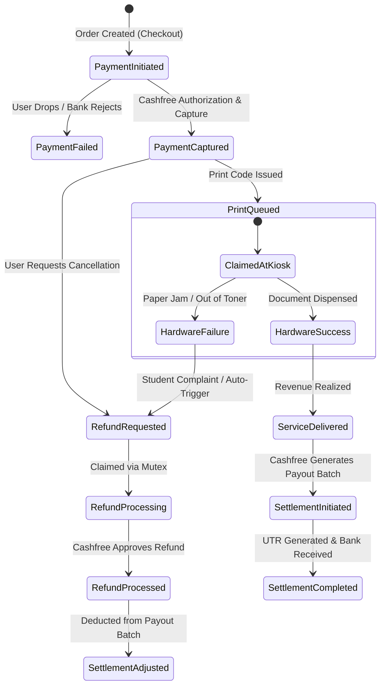
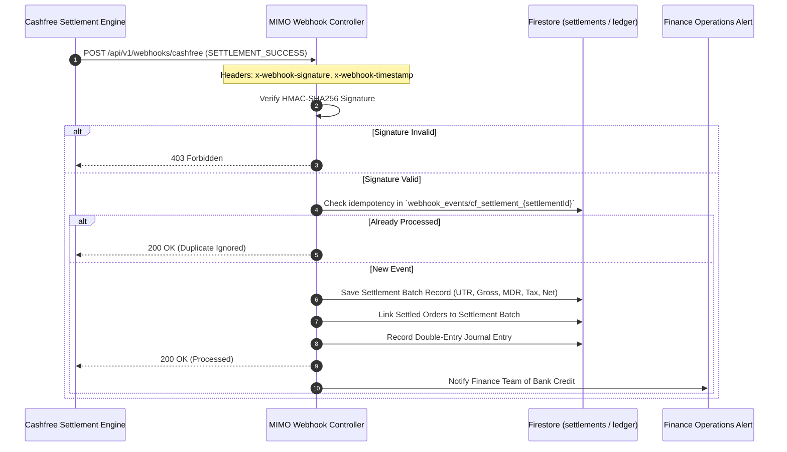
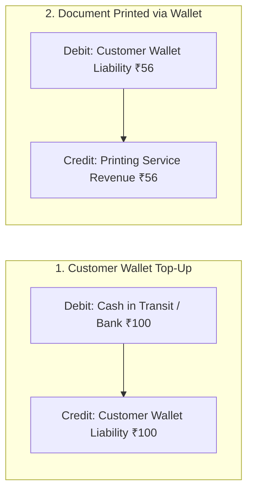

# MIMO FINANCE SPACE — FINANCIAL RECONCILIATION & DATA SPECIFICATION

**Document Version:** 1.0.0  
**Domain:** Financial Ledger, Payment Gateway Reconciliation, and Accounting Accuracy  
**Business Timezone:** Indian Standard Time (IST, UTC+05:30)  
**Currency Unit:** Indian Rupee (INR / ₹) with minor-unit integer calculation (Paise: $1\text{ INR} = 100\text{ Paise}$)

---

## 1. Mandatory Financial Distinctions & State Machine

Financial metrics must strictly respect transaction lifecycles. The diagram below establishes the mandatory state machine separating operational print events from financial cash movements.



### Definitional Boundaries

| Concept | Financial Definition | Event Trigger | Revenue Recognition | Cash Movement |
| :--- | :--- | :--- | :--- | :--- |
| **Payment Initiated** | Customer checkout session opened with Cashfree. | `order_create` API call | NO | NO |
| **Payment Captured** | Funds locked by acquiring bank and confirmed by gateway. | `PAYMENT_SUCCESS_WEBHOOK` | Deferred (Liability) | In Gateway Transit |
| **Service Delivered** | Print job physically verified as dispensed at kiosk. | `print_jobs.status = "completed"` | **YES (Recognized Revenue)** | In Gateway Transit |
| **Refund Requested** | Customer or operator filed a claim for failed print. | `refund_requests` doc created | NO (Reserve set) | NO |
| **Refund Processed** | Gateway approved return of funds to original instrument. | `refunds.status = "SUCCESS"` | Reverse Deferred/Revenue | In Gateway Transit (Outflow) |
| **Gateway Fees (MDR)** | Merchant Discount Rate deducted by Cashfree for processing. | Cashfree Settlement Batch | Expense (COGS) | Deducted from Payout |
| **Net Settlement** | Actual cash transferred to MIMO's current bank account. | UTR credit confirmed in bank | NO (Asset Reclass) | **YES (Bank Account Credit)** |
| **Wallet Top-Up** | Cash deposited by customer for future print usage. | Cashfree Payment Captured | NO (Customer Deposit Liability) | In Gateway Transit / Bank |
| **Wallet Purchase** | Customer uses stored wallet credit to pay for print job. | Print Job Claimed | **YES (Recognized Revenue)** | Internal Liability Debit |

---

## 2. Metric Source-of-Truth Matrix

### 2.1 Gross Collections
- **Business Definition:** Total face-value amount successfully collected from customers across all approved payment methods (UPI, Cards, NetBanking, Cashfree Wallet) before any refunds, gateway charges, or operational deductions.
- **Authoritative Source:** Cashfree Payment Gateway captured payments verified in `payment_transactions` merged with zero-cost coupon orders in `orders`.
- **Inclusion Rules:** All transactions where status is `PAID` or `SUCCESS` with creation/payment timestamp inside reporting interval. Free orders (₹0) included in count but add ₹0.00 to value.
- **Exclusion Rules:** Status `INITIATED`, `PENDING`, `FAILED`, `CANCELLED`, `USER_DROPPED`. Excludes wallet balance top-ups if already counted separately.
- **Formula:**
  $$\text{Gross Collections} = \sum_{i \in \text{Paid Orders}} \text{Amount}_i$$
- **Precision:** Stored as integer Paise ($P = \text{Amount} \times 100$), formatted as `₹(P / 100).toFixed(2)`.

### 2.2 Refunds & Reversals
- **Business Definition:** Total value of funds returned to customers due to hardware errors, cancellations, or administrative adjustments.
- **Authoritative Source:** Cashfree Refund records in `refunds` collection where status is `SUCCESS` or `PROCESSED`.
- **Inclusion Rules:** Refunds whose `processed_at` or `initiatedAt` falls within the reporting period.
- **Special Rule (Prior Period Refunds):** If an order from August is refunded in October, October Gross Collections must **not** be mutated retrospectively. October Net Collections reflects the October refund deduction, while August Gross remains historically immutable.
- **Formula:**
  $$\text{Total Refunds} = \sum_{r \in \text{Completed Refunds}} \text{RefundAmount}_r$$

### 2.3 Net Collections (Internal Operational Metric)
- **Business Definition:** Net customer funds retained by MIMO after deducting customer refunds, before payment gateway fees.
- **Formula:**
  $$\text{Net Collections} = \text{Gross Collections} - \text{Total Refunds Issued in Period}$$

### 2.4 Net Bank Settlement (Treasury Truth)
- **Business Definition:** Actual net rupee liquidity received into MIMO's corporate bank account as confirmed by Cashfree Payout UTR numbers.
- **Authoritative Source:** Cashfree Settlement Reports / Webhooks (`SETTLEMENT_SUCCESS`).
- **Formula:**
  $$\text{Net Settlement} = \text{Gross Settled Amount} - \text{Refund Deductions} - \text{Cashfree Gateway Fee (MDR)} - \text{GST (18\% on MDR)} \pm \text{Adjustments}$$
- **Defect Identified in Existing System:** The existing system equates Net Collections directly with Net Bank Settlement, ignoring MDR fees and settlement timing lags.

### 2.5 Machine-Level Revenue Attribution
- **Business Definition:** Customer revenue earned by each individual physical printing appliance.
- **Authoritative Formula:**
  $$\text{Machine Revenue}_k = \sum_{j \in \text{Jobs}(k, \text{Completed})} \left( \text{OrderAmount} \times \frac{\text{JobCost}_j}{\sum_{m} \text{JobCost}_m} \right) - \text{MachineRefunds}_k$$
- **Rules:**
  1. Multi-job orders allocate the payment proportionally based on each job's sheet/page cost.
  2. Unclaimed jobs remain in `Unclaimed Order Escrow` until physically printed at a specific kiosk.
  3. If print fails and refund is issued, the refund is attributed to the specific machine that experienced the hardware jam.

---

## 3. Cashfree Settlement Integration Architecture

### 3.1 Webhook Specifications

To resolve the complete absence of settlement ingestion, the backend must register and handle Cashfree Settlement Webhook events.



### 3.2 Signature Verification Standard
Every incoming webhook must be verified using raw binary request buffers:

$$\text{Signature} = \text{Base64}\left( \text{HMAC-SHA256}\left( \text{Timestamp} + \text{RawBody}, \text{CASHFREE\_SECRET\_KEY} \right) \right)$$

- Timing-safe buffer comparison (`crypto.timingSafeEqual`) must be enforced to prevent timing attacks.
- Webhooks older than 300 seconds (5 minutes) based on `x-webhook-timestamp` must be rejected to prevent replay attacks.

### 3.3 New Settlement Entity Schema (`cashfree_settlements`)

```typescript
export interface CashfreeSettlementRecord {
  settlementId: string;           // cf_settlement_id
  utrNumber: string;              // Bank UTR reference
  settlementDate: string;         // YYYY-MM-DD
  settledAt: Timestamp;           // Payout completion timestamp
  grossAmountPaise: number;       // Total order amount in batch
  refundAmountPaise: number;      // Refunds deducted from batch
  serviceFeePaise: number;        // Cashfree MDR fee
  serviceTaxPaise: number;        // GST on MDR fee
  adjustmentPaise: number;        // Chargebacks / adjustments
  netAmountPaise: number;         // Actual bank credit (UTR amount)
  orderCount: number;
  orderIds: string[];             // List of orders included
  reconciliationStatus: 'reconciled' | 'discrepancy' | 'manual_review';
  discrepancyAmountPaise?: number;
  notes?: string;
  createdAt: Timestamp;
}
```

---

## 4. Wallet Accounting & Anti-Double-Counting Rules

### 4.1 The Double-Counting Problem
When customer balances are tracked only via mutable user counters (`users.totalSpent`), the following error occurs:
1. Student tops up wallet with ₹100.00 $\rightarrow$ System records ₹100.00 Gross Payment.
2. Student prints 20 B&W pages for ₹56.00 using wallet $\rightarrow$ System records ₹56.00 Order Revenue.
3. System reports total collections as ₹156.00, whereas only ₹100.00 of real cash entered the business.

### 4.2 Standard Ledger Treatment



- **Top-Up Stage:** Cash moves from student to MIMO. Revenue is **NOT** recognized; it is booked as an Unearned Revenue Liability.
- **Print Stage:** Document is dispensed. Revenue is recognized by reducing the Wallet Liability. Zero new cash moves.
- **Reporting Rule:** Financial Dashboards must explicitly distinguish between **Cash Inflow** (Bank Deposits) and **Recognized Operating Revenue** (Executed Print Jobs).

---

## 5. Rounding, Minor Units & Precision Invariants

1. **Integer Minor Units:** All internal database arithmetic, aggregates, and reconciliation checks must execute in integer **Paise** ($1\text{ INR} = 100\text{ Paise}$). Never use JavaScript floating-point addition for monetary balances.
2. **Banker's Rounding (Half to Even):** Where proportional allocations or taxes generate fractional paise, Banker's Rounding must be used to eliminate upward statistical bias.
3. **Reconciliation Invariants:**
   - **Invariant 1 (Order Conservation):** $\text{Gross Amount} = \text{Discount} + \text{Wallet Used} + \text{Gateway Paid}$
   - **Invariant 2 (Batch Conservation):** $\text{Net Payout} = \text{Gross Settled} - \text{Refunds} - \text{MDR} - \text{GST} \pm \text{Adjustments}$
   - **Invariant 3 (Wallet Integrity):** $\text{Current Balance} = \sum \text{Credits} - \sum \text{Debits}$
